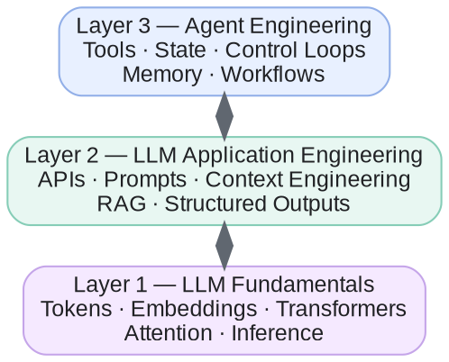

# Glossary

Short definitions of the terms used across the circle, grouped by topic. The weekly concept pages explain how these ideas fit together; come here when you need a quick definition.

The terms fall into three layers, from how a model works to how an agent uses it:

## Core LLM concepts

What an LLM is and how it works.

| Concept | Definition |
| --- | --- |
| Artificial Intelligence (AI) | The broad field of building systems that perform tasks associated with human intelligence. |
| Machine Learning (ML) | A branch of AI in which systems learn patterns from data rather than relying entirely on explicit rules. |
| Deep Learning | Machine learning using neural networks with multiple layers. |
| Neural Network | A computational model composed of interconnected mathematical units with learnable parameters. |
| Generative AI | AI that generates content such as text, images, audio, or code. |
| Large Language Model (LLM) | A neural network trained on large amounts of data to model and generate sequences of tokens. |
| Transformer | A neural network architecture that uses attention mechanisms to process relationships between tokens. |
| Parameters / Weights | Learned numerical values that determine how the model transforms inputs into outputs. |
| Inference | Running a trained model to produce an output from an input. |
| Next-token prediction | Predicting the probability distribution of the next token given the preceding tokens. A common foundation of LLM training and generation. |

## Tokens, embeddings, and attention

How text becomes something a neural network can process.

| Concept | Definition |
| --- | --- |
| Token | A unit of text processed by the model. It can represent a word, part of a word, punctuation, or other text. |
| Tokenization | The process of converting text into a sequence of tokens. |
| Token ID | A numerical identifier assigned to a token by the tokenizer. |
| Embedding | A learned numerical vector representing a token or another item in a multidimensional space. |
| Positional Information | Information that allows the model to distinguish token positions and ordering. |
| Attention | A mechanism that lets the model dynamically weight information from different token positions. |
| Self-attention | Attention between tokens within the same sequence. |
| Causal Masking | A restriction in autoregressive models that prevents a position from attending to future tokens. |
| Logits | Raw scores produced by a model before conversion into probabilities. |
| Softmax | A mathematical function that converts logits into a probability distribution. |

## Context and context engineering

What the model sees on each call.

| Concept | Definition |
| --- | --- |
| Prompt | Instructions or input provided to a model to guide its response. |
| System Instructions | High-priority instructions supplied by the application or platform to establish behavior and constraints. |
| User Message | The request or information submitted by the user. |
| Context | The information available to the model during a particular inference, including instructions, messages, and relevant data. |
| Context Window | The maximum amount of tokenized information a model can process in one context, subject to model and API limits. |
| Context Engineering | Selecting, organizing, transforming, and managing information supplied to a model so it can perform a task effectively. |
| Conversation History | Previous messages that an application retains and may supply in subsequent model calls. |
| Context Compaction | Compressing or summarizing information to reduce token usage while preserving important details. |
| Context Truncation | Removing some information when a context exceeds a configured limit. |
| Prompt Injection | An attempt to make a model follow malicious or unintended instructions embedded in lower-trust content. |

## Model training and adaptation

How an LLM acquires its capabilities and how developers customize it.

| Concept | Definition |
| --- | --- |
| Pretraining | Training a model on large datasets, often using next-token prediction, to learn general patterns and representations. |
| Training Dataset | The collection of examples used to train a model. |
| Loss Function | A mathematical measure of how far the model's predictions are from its training targets. |
| Gradient Descent | An optimization approach that updates model parameters to reduce loss. |
| Backpropagation | An algorithm for computing gradients through a neural network. |
| Epoch | One complete pass through a training dataset. |
| Fine-tuning | Additional training of a pretrained model for a particular task, domain, or behavior. |
| Supervised Fine-Tuning (SFT) | Training on examples of desired inputs and outputs. |
| Reinforcement Learning (RL) | Training that optimizes behavior using reward signals. |
| RLHF | Reinforcement Learning from Human Feedback, which uses human preference information to help train model behavior. |
| DPO | Direct Preference Optimization, a method for training a model using preference comparisons without a separate RL optimization loop. |
| LoRA | Low-Rank Adaptation, a parameter-efficient fine-tuning technique that trains small additional matrices rather than updating all original weights. |
| Distillation | Training a smaller or different model to reproduce useful behavior from a teacher model. |
| Quantization | Representing model weights or computations at reduced numerical precision to lower memory or compute requirements. |

## Inference and generation parameters

Terms you meet when calling an LLM API.

| Concept | Definition |
| --- | --- |
| Input Tokens | Tokens supplied to the model, including relevant instructions, conversation history, and other context. |
| Output Tokens | Tokens generated by the model. |
| Temperature | A sampling parameter that adjusts the randomness of token selection. |
| Top-p | Nucleus sampling: restricts sampling to the smallest set of tokens whose cumulative probability reaches a specified threshold. |
| Max Output Tokens | A limit on how many tokens a response may generate. |
| Stop Sequence | A configured sequence that causes generation to stop when encountered. |
| Streaming | Delivering generated output incrementally rather than waiting for the entire response. |
| Latency | The time taken to produce a response. |
| Time to First Token (TTFT) | The time from a request until the first output token is received. |
| Tokens per Second | A measure of generation throughput. |
| KV Cache | Cached attention keys and values that reduce repeated computation during autoregressive generation. |
| Prompt Caching | Reusing computation associated with previously processed input prefixes, when supported by the service. |

## LLM APIs and application engineering

Building software on top of a model service.

| Concept | Definition |
| --- | --- |
| API | Application Programming Interface: a defined way for software systems to communicate. |
| REST API | An API style using HTTP methods and resource-oriented interfaces. |
| SDK | Software Development Kit: libraries that simplify interaction with an API. |
| API Key | A credential used to authenticate requests to a service. |
| Model Endpoint | An API interface through which an application accesses model capabilities. |
| System Prompt | Application-provided instructions defining a model's role, behavior, and constraints. |
| Structured Output | A model response constrained to a defined format, such as a JSON schema. |
| Function Calling / Tool Calling | A mechanism through which a model requests an operation using a defined tool interface. |
| Rate Limit | A restriction on how many requests or tokens can be processed within a period. |
| Retry | Reattempting a failed request, usually with limits and backoff. |
| Idempotency | A property that allows an operation to be repeated without creating additional unintended effects. |

## RAG, knowledge, and memory

Supplying information beyond the model's learned parameters.

| Concept | Definition |
| --- | --- |
| Retrieval-Augmented Generation (RAG) | Retrieving relevant external information and supplying it as context for model generation. |
| Vector Embedding | A numerical representation that can be used to compare semantic similarity between items. |
| Vector Database | A system for storing vectors and searching for similar representations. |
| Semantic Search | Searching based on meaning or similarity rather than exact keyword matching alone. |
| Chunking | Splitting documents into smaller sections for indexing and retrieval. |
| Similarity Search | Finding vectors close to a query vector under a similarity or distance metric. |
| Hybrid Search | Combining approaches such as keyword search and vector search. |
| Reranking | Reordering retrieved results using a more detailed relevance model or scoring method. |
| Short-term Memory | Information maintained for the current conversation or task, often in active context or application state. |
| Long-term Memory | Information stored persistently and retrieved across sessions or tasks. |
| Grounding | Basing model responses on supplied evidence, retrieved data, or other verifiable information. |
| Hallucination | Generated content that is false, unsupported, or fabricated despite appearing plausible. |

## AI agents and agent engineering

Combining the LLM with tools, state, and an execution process.

| Concept | Definition |
| --- | --- |
| AI Agent | A system that uses a model to select or perform actions toward a goal, often across multiple steps. |
| Agent Engineering | Designing and implementing the tools, state, control logic, context, and safeguards that enable an agent to complete tasks. |
| Tool | A function or external capability an agent can invoke, such as web search, a database query, or a code executor. |
| Tool Schema | A structured definition of a tool's name, purpose, and expected arguments. |
| State | Stored information describing the system's current condition, progress, and relevant results. |
| Control Loop | A repeated process of evaluating the current situation, deciding what to do, acting, and checking results. |
| Planning | Breaking a goal into steps or selecting a sequence of actions. |
| Orchestration | Coordinating execution, model calls, tools, and possibly multiple agents. |
| Workflow | A defined sequence or graph of steps used to accomplish a task. |
| Multi-agent System | A system containing multiple agents that cooperate, delegate, or coordinate tasks. |
| Human-in-the-Loop | A design in which a person reviews, approves, or corrects parts of an automated process. |
| Guardrails | Constraints and checks that limit unsafe, unauthorized, or invalid system behavior. |
| Evaluation (Evals) | Systematic testing of model or agent performance against defined criteria. |
| Observability | Collecting traces, logs, metrics, and other evidence to understand system behavior. |
| Checkpoint | A saved state that allows a workflow to resume or recover. |

## Additional concepts

Useful once the fundamentals are in place.

| Concept | Definition |
| --- | --- |
| Multimodal Model | A model that can process or generate multiple data types, such as text, images, audio, and video. |
| Reasoning Model | A model trained or configured to perform more extensive reasoning before producing an answer. |
| Test-time Compute | Computation allocated during inference, potentially including additional reasoning or search. |
| Model Context Protocol (MCP) | An open protocol for connecting AI applications to external tools and information sources. |
| Webhook | An HTTP notification sent by one system to another when an event occurs. |
| Model Routing | Selecting different models for different tasks based on factors such as cost, latency, or capability. |
| Model Benchmark | A standardized test used to measure particular model capabilities. |
| LLM-as-a-Judge | Using an LLM to evaluate another model's output against defined criteria. |
| Prompt Evaluation | Testing how changes in instructions affect model performance. |
| Agent Trace | A record of the model calls, tool calls, decisions, and results during an agent execution. |
