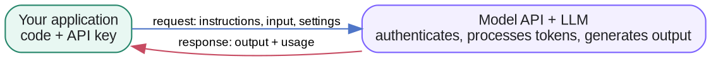
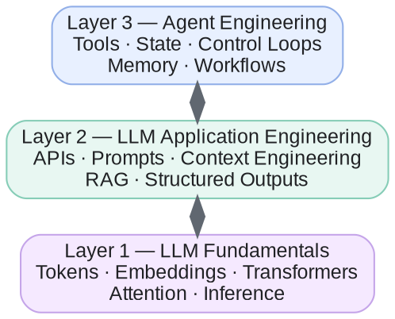

# Week 1 · LLM Fundamentals — Concepts

## At a glance

| Learn | Build | Key terms | Watch for |
| --- | --- | --- | --- |
| How an LLM generates tokens and where it fits in an app | A first API call with structured output | Tokens, context, prompts, API | An LLM does not retain prior API calls unless the app supplies history |

This page explains how the core ideas fit together. Short definitions of every term are in the **Glossary** (sidebar → 📚 Knowledge Base → Glossary).

## 1. How an LLM generates text

```graphviz
digraph next_token {
  rankdir=LR; bgcolor="transparent"; nodesep=.45; ranksep=.65;
  node [shape=box style="rounded,filled" fontname="Arial" fontsize=12 color="#7B61FF" fillcolor="#F3F0FF" fontcolor="#202124" margin=".18,.10"];
  prompt [label="Input text\nThe cat sat on the"];
  tokens [label="Tokens\nThe | cat | sat | on | the" fillcolor="#E8F7F2" color="#25866A"];
  model [label="LLM\ncalculates next-token probabilities" fillcolor="#E8F0FF" color="#4F76C8"];
  choices [label="likely next tokens\nmat  0.62   floor  0.13   chair  0.08" fillcolor="#FFF6DE" color="#C68B20"];
  output [label="Select “mat”\nand repeat" fillcolor="#FFECEE" color="#C74B62"];
  prompt -> tokens -> model -> choices -> output;
}
```

Think of the autocomplete on your phone keyboard. You type "See you", and it suggests "soon", "tomorrow", or "later". An LLM does the same thing, just far better: it has read a huge amount of text, so it is very good at guessing **what word comes next**.

It writes a whole answer by guessing one piece at a time:

| Step | Text so far | Most likely next piece | Added |
| --- | --- | --- | --- |
| 1 | The cat sat on the | mat (62%), floor (13%), chair (8%) | mat |
| 2 | The cat sat on the mat | . (period) | . |
| 3 | The cat sat on the mat. | *(end of answer)* | stop |

That is the whole trick, repeated: look at all the text so far, guess the next piece, add it, and go again. A long answer is just hundreds of these small guesses in a row. Three things follow from this:

- **It predicts; it doesn't look things up.** A fluent, confident answer can still be wrong (a "hallucination").
- **Answers can vary.** The model picks among likely options, so the same question can get different wording each time. Settings like *temperature* control how adventurous the picks are.
- **The pieces are tokens, not words.** A token is often a whole word, but can be part of a word or a punctuation mark.

Under the hood, the same steps look like this:

## 2. How do we use an LLM?

An LLM API provides a programming interface to a model service.

### What happens when you call an LLM API?

You can use JavaScript, Python, or another supported language to build an LLM application. The language you use to call the API is separate from the language used to train or run the model.

## 3. Does an LLM remember previous API calls?

A standard stateless LLM inference does not automatically remember earlier API calls.

Your application must provide the relevant previous information again, or use a service that manages conversation state for you.

Context engineering is how the application decides what the model should know for the current call.

## 4. Does an LLM know your private information?

No. A model only knows what was in its training data. That data stops at a cutoff date, and it never included your emails, your notes, or your company's documents.

Ask a plain LLM "When is my dentist appointment?" and it can only guess or say it doesn't know. To answer, your application has to **find the relevant information and put it in the prompt**:

1. The app searches your calendar or notes and finds "Dentist, Tuesday 3 pm".
2. It adds that line to the prompt with your question.
3. The model reads it and answers: "Tuesday at 3 pm."

This is called **RAG** (retrieval-augmented generation): retrieve the right information, then let the model generate an answer from it. Week 3 builds one.

## 5. AI agents and agent engineering

An LLM on its own only writes text. An **agent** puts the LLM inside a system that can also take actions, such as searching the web, reading a calendar, or sending an email, step by step toward a goal.

It helps to think of three layers, each built on the one below:

The LLM predicts text (section 1), the application calls it and decides what it sees (sections 2–4), and the agent uses both to get something done. This course climbs these layers week by week.

### Agent categories and examples

"Agent" is a broad term. The categories below describe common system designs, and a real product can combine more than one of them. The final column names well-known companies and products rather than hypothetical use cases.

| Category | What it does | Notable companies and products |
| --- | --- | --- |
| General-purpose or personal agent | Handles open-ended, multi-step work in a conversation and may use personal context or connected apps. | OpenAI — ChatGPT agent; Anthropic — Claude; Google — Gemini; Meta — Muse; xAI — Grok; Microsoft — Copilot. |
| Research agent | Searches, gathers sources, synthesizes findings, and prepares a report. | OpenAI — Deep Research; Perplexity — Deep Research; Google — Gemini Deep Research. |
| Coding agent | Reads and changes a codebase, runs commands or tests, and helps deliver software. | OpenAI — Codex; Anthropic — Claude Code; Cognition — Devin; Cursor — Cursor. |
| Browser or computer-use agent | Uses a browser or computer interface to navigate sites and complete tasks. | OpenAI — ChatGPT agent; Anthropic — Claude in Chrome; Manus — Manus. |
| Enterprise knowledge and workflow agent | Uses company data and business tools within defined permissions and workflows. | Microsoft — Copilot Studio; Salesforce — Agentforce; Glean — Glean Agents; ServiceNow — AI Agents. |
| Customer-service agent | Resolves support questions and, where permitted, completes service actions. | Intercom — Fin; Zendesk — AI agents; Ada — Ada. |
| Multi-agent platform | Coordinates specialist agents or provides the framework to build them. | Microsoft — AutoGen; Google — Agent Development Kit; CrewAI — CrewAI; LangChain — LangGraph. |

The safest starting point is usually a narrow workflow or tool-using agent with explicit permissions, clear stop conditions, and human approval for consequential actions. Add planning, additional tools, or multiple agents only when the task genuinely needs them.

## References

- [OpenAI API — Text generation](https://developers.openai.com/api/docs/guides/text)
- [OpenAI API — Prompt engineering](https://developers.openai.com/api/docs/guides/prompt-engineering)
- [Attention Is All You Need (the Transformer paper)](https://arxiv.org/abs/1706.03762)
- [OpenAI API — Key concepts](https://developers.openai.com/api/docs/concepts)
- [Hugging Face LLM Course](https://huggingface.co/learn/llm-course/chapter1/1)
