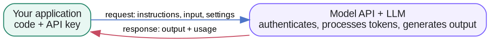
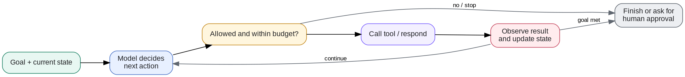

# Week 1 · LLM Fundamentals — Concepts

## At a glance

| Learn | Build | Key terms | Watch for |
| --- | --- | --- | --- |
| How an LLM generates tokens and where it fits in an app | A first API call with structured output | Tokens, context, prompts, temperature, API | An LLM does not retain prior API calls unless the app supplies history |

## 1. How an LLM generates text

```graphviz
digraph next_token {
  rankdir=LR; bgcolor="transparent"; nodesep=.45; ranksep=.65;
  node [shape=box style="rounded,filled" fontname="Arial" fontsize=12 color="#7B61FF" fillcolor="#F3F0FF" fontcolor="#202124" margin=".18,.10"];
  prompt [label="Input text\nThe cat sat on the"];
  tokens [label="Tokens\nThe | cat | sat | on | the" fillcolor="#E8F7F2" color="#25866A"];
  model [label="LLM\ncalculates next-token probabilities" fillcolor="#E8F0FF" color="#4F76C8"];
  choices [label="likely next tokens\nmat  0.62   floor  0.13   chair  0.08" fillcolor="#FFF6DE" color="#C68B20"];
  output [label="Select “mat”\nand repeat" fillcolor="#FFECEE" color="#C74B62"];
  prompt -> tokens -> model -> choices -> output;
}
```

The model predicts the next token, appends it to the text, and repeats until a stopping condition is reached.

## 2. Tokens, embeddings, and attention

These concepts explain how text becomes something a neural network can process.

| Concept | Definition |
| --- | --- |
| Token | A unit of text processed by the model. It can represent a word, part of a word, punctuation, or other text. |
| Tokenization | The process of converting text into a sequence of tokens. |
| Token ID | A numerical identifier assigned to a token by the tokenizer. |
| Embedding | A learned numerical vector representing a token or another item in a multidimensional space. |
| Positional Information | Information that allows the model to distinguish token positions and ordering. |
| Attention | A mechanism that lets the model dynamically weight information from different token positions. |
| Self-attention | Attention between tokens within the same sequence. |
| Causal Masking | A restriction in autoregressive models that prevents a position from attending to future tokens. |
| Logits | Raw scores produced by a model before conversion into probabilities. |
| Softmax | A mathematical function that converts logits into a probability distribution. |

Example: In the sentence "The dog chased the ball because it was excited," attention can help the model use the surrounding context to interpret what "it" refers to.

## 3. Context and context engineering

This is especially important for your AI agent learning.

| Concept | Definition |
| --- | --- |
| Prompt | Instructions or input provided to a model to guide its response. |
| System Instructions | High-priority instructions supplied by the application or platform to establish behavior and constraints. |
| User Message | The request or information submitted by the user. |
| Context | The information available to the model during a particular inference, including instructions, messages, and relevant data. |
| Context Window | The maximum amount of tokenized information a model can process in one context, subject to model and API limits. |
| Context Engineering | Selecting, organizing, transforming, and managing information supplied to a model so it can perform a task effectively. |
| Conversation History | Previous messages that an application retains and may supply in subsequent model calls. |
| Context Compaction | Compressing or summarizing information to reduce token usage while preserving important details. |
| Context Truncation | Removing some information when a context exceeds a configured limit. |
| Prompt Injection | An attempt to make a model follow malicious or unintended instructions embedded in lower-trust content. |

### A critical concept: Does an LLM remember previous API calls?

A standard stateless LLM inference does not automatically remember earlier API calls.

Your application must provide the relevant previous information again, or use a service that manages conversation state for you.

Context engineering is how the application decides what the model should know for the current call.

## 4. Model training and adaptation

These concepts explain how an LLM acquires its capabilities and how developers can customize it.

| Concept | Definition |
| --- | --- |
| Pretraining | Training a model on large datasets, often using next-token prediction, to learn general patterns and representations. |
| Training Dataset | The collection of examples used to train a model. |
| Loss Function | A mathematical measure of how far the model's predictions are from its training targets. |
| Gradient Descent | An optimization approach that updates model parameters to reduce loss. |
| Backpropagation | An algorithm for computing gradients through a neural network. |
| Epoch | One complete pass through a training dataset. |
| Fine-tuning | Additional training of a pretrained model for a particular task, domain, or behavior. |
| Supervised Fine-Tuning (SFT) | Training on examples of desired inputs and outputs. |
| Reinforcement Learning (RL) | Training that optimizes behavior using reward signals. |
| RLHF | Reinforcement Learning from Human Feedback, which uses human preference information to help train model behavior. |
| DPO | Direct Preference Optimization, a method for training a model using preference comparisons without a separate RL optimization loop. |
| LoRA | Low-Rank Adaptation, a parameter-efficient fine-tuning technique that trains small additional matrices rather than updating all original weights. |
| Distillation | Training a smaller or different model to reproduce useful behavior from a teacher model. |
| Quantization | Representing model weights or computations at reduced numerical precision to lower memory or compute requirements. |

An important distinction: Fine-tuning changes model parameters; context engineering changes the information supplied to a model at inference time.

## 5. Inference and generation parameters

When calling an LLM API, you will encounter these terms.

| Concept | Definition |
| --- | --- |
| Input Tokens | Tokens supplied to the model, including relevant instructions, conversation history, and other context. |
| Output Tokens | Tokens generated by the model. |
| Temperature | A sampling parameter that adjusts the randomness of token selection. |
| Top-p | Nucleus sampling: restricts sampling to the smallest set of tokens whose cumulative probability reaches a specified threshold. |
| Max Output Tokens | A limit on how many tokens a response may generate. |
| Stop Sequence | A configured sequence that causes generation to stop when encountered. |
| Streaming | Delivering generated output incrementally rather than waiting for the entire response. |
| Latency | The time taken to produce a response. |
| Time to First Token (TTFT) | The time from a request until the first output token is received. |
| Tokens per Second | A measure of generation throughput. |
| KV Cache | Cached attention keys and values that reduce repeated computation during autoregressive generation. |
| Prompt Caching | Reusing computation associated with previously processed input prefixes, when supported by the service. |

For example, a low temperature generally produces more concentrated token choices, while a higher temperature allows more varied output. It does not guarantee factual correctness.

## 6. LLM APIs and application engineering

An LLM API provides a programming interface to a model service.

| Concept | Definition |
| --- | --- |
| API | Application Programming Interface: a defined way for software systems to communicate. |
| REST API | An API style using HTTP methods and resource-oriented interfaces. |
| SDK | Software Development Kit: libraries that simplify interaction with an API. |
| API Key | A credential used to authenticate requests to a service. |
| Model Endpoint | An API interface through which an application accesses model capabilities. |
| System Prompt | Application-provided instructions defining a model's role, behavior, and constraints. |
| Structured Output | A model response constrained to a defined format, such as a JSON schema. |
| Function Calling / Tool Calling | A mechanism through which a model requests an operation using a defined tool interface. |
| Rate Limit | A restriction on how many requests or tokens can be processed within a period. |
| Retry | Reattempting a failed request, usually with limits and backoff. |
| Idempotency | A property that allows an operation to be repeated without creating additional unintended effects. |

### What happens when you call an LLM API?

You can use JavaScript, Python, or another supported language to build an LLM application. The language you use to call the API is separate from the language used to train or run the model.

## 7. RAG, knowledge, and memory

These are techniques for supplying information beyond the model's learned parameters.

| Concept | Definition |
| --- | --- |
| Retrieval-Augmented Generation (RAG) | Retrieving relevant external information and supplying it as context for model generation. |
| Vector Embedding | A numerical representation that can be used to compare semantic similarity between items. |
| Vector Database | A system for storing vectors and searching for similar representations. |
| Semantic Search | Searching based on meaning or similarity rather than exact keyword matching alone. |
| Chunking | Splitting documents into smaller sections for indexing and retrieval. |
| Similarity Search | Finding vectors close to a query vector under a similarity or distance metric. |
| Hybrid Search | Combining approaches such as keyword search and vector search. |
| Reranking | Reordering retrieved results using a more detailed relevance model or scoring method. |
| Short-term Memory | Information maintained for the current conversation or task, often in active context or application state. |
| Long-term Memory | Information stored persistently and retrieved across sessions or tasks. |
| Grounding | Basing model responses on supplied evidence, retrieved data, or other verifiable information. |
| Hallucination | Generated content that is false, unsupported, or fabricated despite appearing plausible. |

### RAG versus fine-tuning

| RAG | Fine-tuning |
| --- | --- |
| Retrieves external information at inference time | Updates model parameters through training |
| Can incorporate frequently changing documents | Useful for adapting behavior, style, or specialized tasks |
| Does not inherently modify the model | Modifies model behavior |
| Requires a retrieval pipeline | Requires training data and compute |

For an agent that needs to answer questions about CircleW's current features, RAG could retrieve the latest product documentation. Fine-tuning would not be necessary just to give it access to those documents.

## 8. AI agents and agent engineering

This layer combines the LLM with tools, state management, and an execution process.

| Concept | Definition |
| --- | --- |
| AI Agent | A system that uses a model to select or perform actions toward a goal, often across multiple steps. |
| Agent Engineering | Designing and implementing the tools, state, control logic, context, and safeguards that enable an agent to complete tasks. |
| Tool | A function or external capability an agent can invoke, such as web search, a database query, or a code executor. |
| Tool Schema | A structured definition of a tool's name, purpose, and expected arguments. |
| State | Stored information describing the system's current condition, progress, and relevant results. |
| Control Loop | A repeated process of evaluating the current situation, deciding what to do, acting, and checking results. |
| Planning | Breaking a goal into steps or selecting a sequence of actions. |
| Orchestration | Coordinating execution, model calls, tools, and possibly multiple agents. |
| Workflow | A defined sequence or graph of steps used to accomplish a task. |
| Multi-agent System | A system containing multiple agents that cooperate, delegate, or coordinate tasks. |
| Human-in-the-Loop | A design in which a person reviews, approves, or corrects parts of an automated process. |
| Guardrails | Constraints and checks that limit unsafe, unauthorized, or invalid system behavior. |
| Evaluation (Evals) | Systematic testing of model or agent performance against defined criteria. |
| Observability | Collecting traces, logs, metrics, and other evidence to understand system behavior. |
| Checkpoint | A saved state that allows a workflow to resume or recover. |

### Agent categories and examples

"Agent" is a broad term. The categories below describe common system designs, and a real product can combine more than one of them. The final column names well-known companies and products rather than hypothetical use cases.

| Category | What it does | Notable companies and products |
| --- | --- | --- |
| General-purpose or personal agent | Handles open-ended, multi-step work in a conversation and may use personal context or connected apps. | OpenAI — ChatGPT agent; Anthropic — Claude; Google — Gemini; Meta — Muse; xAI — Grok; Microsoft — Copilot. |
| Research agent | Searches, gathers sources, synthesizes findings, and prepares a report. | OpenAI — Deep Research; Perplexity — Deep Research; Google — Gemini Deep Research. |
| Coding agent | Reads and changes a codebase, runs commands or tests, and helps deliver software. | OpenAI — Codex; Anthropic — Claude Code; Cognition — Devin; Cursor — Cursor. |
| Browser or computer-use agent | Uses a browser or computer interface to navigate sites and complete tasks. | OpenAI — ChatGPT agent; Anthropic — Claude in Chrome; Manus — Manus. |
| Enterprise knowledge and workflow agent | Uses company data and business tools within defined permissions and workflows. | Microsoft — Copilot Studio; Salesforce — Agentforce; Glean — Glean Agents; ServiceNow — AI Agents. |
| Customer-service agent | Resolves support questions and, where permitted, completes service actions. | Intercom — Fin; Zendesk — AI agents; Ada — Ada. |
| Multi-agent platform | Coordinates specialist agents or provides the framework to build them. | Microsoft — AutoGen; Google — Agent Development Kit; CrewAI — CrewAI; LangChain — LangGraph. |

The safest starting point is usually a narrow workflow or tool-using agent with explicit permissions, clear stop conditions, and human approval for consequential actions. Add planning, additional tools, or multiple agents only when the task genuinely needs them.

### The agent control loop

In practice, an agent also needs termination conditions for errors, budget limits, repeated failures, and situations requiring human approval. Not every workflow needs a model-driven loop; a fixed sequence of API calls may be sufficient for simpler tasks.

## 9. Additional concepts worth knowing

Once you understand the fundamentals, these concepts will help you design more capable AI products.

| Concept | Definition |
| --- | --- |
| Multimodal Model | A model that can process or generate multiple data types, such as text, images, audio, and video. |
| Reasoning Model | A model trained or configured to perform more extensive reasoning before producing an answer. |
| Test-time Compute | Computation allocated during inference, potentially including additional reasoning or search. |
| Model Context Protocol (MCP) | An open protocol for connecting AI applications to external tools and information sources. |
| Webhook | An HTTP notification sent by one system to another when an event occurs. |
| Model Routing | Selecting different models for different tasks based on factors such as cost, latency, or capability. |
| Model Benchmark | A standardized test used to measure particular model capabilities. |
| LLM-as-a-Judge | Using an LLM to evaluate another model's output against defined criteria. |
| Prompt Evaluation | Testing how changes in instructions affect model performance. |
| Agent Trace | A record of the model calls, tool calls, decisions, and results during an agent execution. |

## References

- [OpenAI API — Text generation](https://developers.openai.com/api/docs/guides/text)
- [OpenAI API — Prompt engineering](https://developers.openai.com/api/docs/guides/prompt-engineering)
- [Attention Is All You Need (the Transformer paper)](https://arxiv.org/abs/1706.03762)
- [OpenAI API — Key concepts](https://developers.openai.com/api/docs/concepts)
- [Hugging Face LLM Course](https://huggingface.co/learn/llm-course/chapter1/1)
