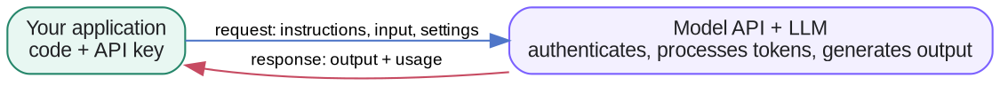
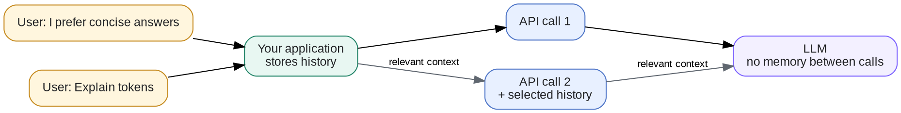
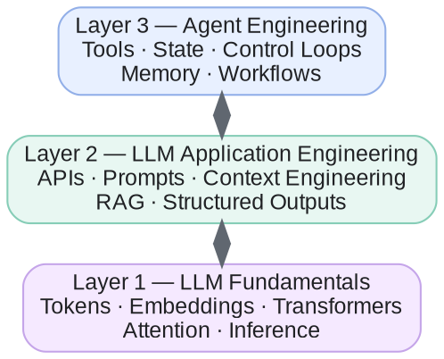

# Week 1 · LLM Fundamentals — Concepts

## At a glance

| Learn | Build | Key terms | Watch for |
| --- | --- | --- | --- |
| How an LLM writes text, how applications use it, and what it cannot do on its own | Your first program that calls an LLM and gets a structured answer back | Token, prompt, API, context, agent | An LLM does not remember earlier calls; your application must send the history each time |

This page explains how the core ideas fit together. For a short definition of any term, see the **Glossary** (sidebar → 📚 Knowledge Base → Glossary).

## 1. How an LLM generates text

```graphviz
digraph next_token {
  rankdir=LR; bgcolor="transparent"; nodesep=.45; ranksep=.65;
  node [shape=box style="rounded,filled" fontname="Arial" fontsize=12 color="#7B61FF" fillcolor="#F3F0FF" fontcolor="#202124" margin=".18,.10"];
  prompt [label="Input text\nThe cat sat on the"];
  tokens [label="Tokens\nThe | cat | sat | on | the" fillcolor="#E8F7F2" color="#25866A"];
  model [label="LLM\ncalculates next-token probabilities" fillcolor="#E8F0FF" color="#4F76C8"];
  choices [label="likely next tokens\nmat  0.62   floor  0.13   chair  0.08" fillcolor="#FFF6DE" color="#C68B20"];
  output [label="Select “mat”\nand repeat" fillcolor="#FFECEE" color="#C74B62"];
  prompt -> tokens -> model -> choices -> output;
}
```

A large language model (LLM) works much like the autocomplete on a phone keyboard. Type "See you" and the keyboard suggests "soon", "tomorrow", or "later". An LLM does the same thing at far greater scale: it has learned from a vast amount of text, so it is very good at predicting **what comes next**.

It writes a full answer one small piece at a time:

| Step | Text so far | Most likely next piece | Added |
| --- | --- | --- | --- |
| 1 | The cat sat on the | mat (62%), floor (13%), chair (8%) | mat |
| 2 | The cat sat on the mat | . (period) | . |
| 3 | The cat sat on the mat. | *(end of answer)* | stop |

The model repeats the same step: read all the text so far, predict the next piece, add it, and continue. A long answer is simply hundreds of these predictions in a row. Three practical consequences follow:

- **It predicts; it does not look things up.** A fluent, confident answer can still be wrong. This is called a *hallucination*.
- **Answers can vary.** The model chooses among likely options, so the same question can produce different wording. A setting called *temperature* controls how much variety you get.
- **The pieces are tokens, not words.** A token is often a whole word, but it can also be part of a word or a punctuation mark. Usage and pricing are measured in tokens.

The same process, step by step:

## 2. How do we use an LLM?

Most people first meet an LLM in a chat app such as ChatGPT, Claude, or Gemini. When you build your own application, you use the same models through an **API** (application programming interface): your code sends a request to the model provider over the internet and receives the answer back.

A request usually contains three things:

- **Instructions** that set the model's role and rules, often called the *system prompt* (for example, "You are a helpful assistant. Answer in two sentences.").
- **The input**, such as the user's question.
- **Settings**, such as which model to use and the maximum length of the answer.

The response contains the generated text plus **usage**: how many tokens went in and came out, which is what you are billed for.

Every request is signed with an **API key**, a secret password that identifies your account. Keep it out of your code and never share it publicly. You can call an API from Python, JavaScript, or almost any other language; this week's lab uses Python.

## 3. What an LLM cannot do on its own

An LLM only predicts text from what you send it in a single request. Two limits follow directly, and each has a standard fix you will build later in the course.

### 3.1 It does not remember previous API calls

Each API call starts from a blank slate. The model has no memory of anything you sent before.

Chat apps only *feel* like they remember because the app quietly sends the earlier conversation along with every new message. When you build your own application, that job is yours: store the history and include whatever the model needs on each call.

In the example above, if the second call does not include "I prefer concise answers", the model has no way of knowing that preference.

Sending history has a cost. More text means more tokens, which means slower and more expensive calls, and every model has a limit on how much it can read at once (its *context window*). Deciding what to include on each call is called **context engineering**, the topic of Week 2.

### 3.2 It does not know your private or recent information

A model only knows what was in its training data. That data stops at a cutoff date, so the model does not know recent events, and it never included your emails, your notes, or your company's documents.

Ask a plain LLM "When is my dentist appointment?" and it can only guess or say it does not know. To answer, your application has to **find the relevant information and put it in the request**:

1. The app searches your calendar or notes and finds "Dentist, Tuesday 3 pm".
2. It adds that line to the request, together with your question.
3. The model reads it and answers: "Tuesday at 3 pm."

This approach is called **RAG** (retrieval-augmented generation): retrieve the right information first, then let the model generate an answer from it. You will build one in Week 3.

## 4. AI agents and agent engineering

On its own, an LLM only produces text. An **agent** places the LLM inside a system that can also take actions, such as searching the web, reading a calendar, or sending an email, and works step by step toward a goal.

It helps to think in three layers, each built on the one below:

The LLM predicts text (section 1). The application calls it and decides what it sees (sections 2–3). The agent combines both to get something done. The course climbs these layers week by week.

### Agent categories and examples

"Agent" is a broad term. The categories below describe common designs; a real product often combines more than one.

| Category | What it does | Notable companies and products |
| --- | --- | --- |
| General-purpose or personal agent | Open-ended, multi-step help, often using your connected apps | OpenAI — ChatGPT agent Anthropic — Claude Google — Gemini Meta — Muse xAI — Grok Microsoft — Copilot |
| Research agent | Gathers sources and writes a report | OpenAI — Deep Research Perplexity — Deep Research Google — Gemini Deep Research |
| Coding agent | Reads and edits code, runs tests | OpenAI — Codex Anthropic — Claude Code Cognition — Devin Cursor — Cursor |
| Browser or computer-use agent | Uses websites and apps to finish tasks | OpenAI — ChatGPT agent Anthropic — Claude in Chrome Manus — Manus |
| Enterprise knowledge and workflow agent | Works with company data and business tools | Microsoft — Copilot Studio Salesforce — Agentforce Glean — Glean Agents ServiceNow — AI Agents |
| Customer-service agent | Answers and resolves support requests | Intercom — Fin Zendesk — AI agents Ada — Ada |
| Multi-agent platform | Coordinates several specialist agents | Microsoft — AutoGen Google — Agent Development Kit CrewAI — CrewAI LangChain — LangGraph |

A good first agent is narrow: a few well-defined tools, clear permissions, a clear point at which it stops, and human approval before anything consequential, such as sending a message or spending money. Add more tools, planning, or multiple agents only when the task genuinely needs them.

## References

- [OpenAI API — Text generation](https://developers.openai.com/api/docs/guides/text)
- [OpenAI API — Prompt engineering](https://developers.openai.com/api/docs/guides/prompt-engineering)
- [Attention Is All You Need (the Transformer paper)](https://arxiv.org/abs/1706.03762)
- [OpenAI API — Key concepts](https://developers.openai.com/api/docs/concepts)
- [Hugging Face LLM Course](https://huggingface.co/learn/llm-course/chapter1/1)
