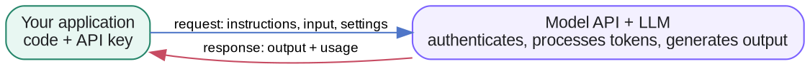
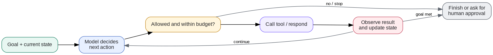

# Week 1 · LLM Fundamentals — Concepts

## At a glance

| Learn | Build | Key terms | Watch for |
| --- | --- | --- | --- |
| How an LLM generates tokens and where it fits in an app | A first API call with structured output | Tokens, context, prompts, temperature, API | An LLM does not retain prior API calls unless the app supplies history |

This page explains how the core ideas fit together. Short definitions of every term are in the **Glossary** (sidebar → 📚 Knowledge Base → Glossary).

## 1. How an LLM generates text

```graphviz
digraph next_token {
  rankdir=LR; bgcolor="transparent"; nodesep=.45; ranksep=.65;
  node [shape=box style="rounded,filled" fontname="Arial" fontsize=12 color="#7B61FF" fillcolor="#F3F0FF" fontcolor="#202124" margin=".18,.10"];
  prompt [label="Input text\nThe cat sat on the"];
  tokens [label="Tokens\nThe | cat | sat | on | the" fillcolor="#E8F7F2" color="#25866A"];
  model [label="LLM\ncalculates next-token probabilities" fillcolor="#E8F0FF" color="#4F76C8"];
  choices [label="likely next tokens\nmat  0.62   floor  0.13   chair  0.08" fillcolor="#FFF6DE" color="#C68B20"];
  output [label="Select “mat”\nand repeat" fillcolor="#FFECEE" color="#C74B62"];
  prompt -> tokens -> model -> choices -> output;
}
```

The model predicts the next token, appends it to the text, and repeats until a stopping condition is reached.

## 2. Does an LLM remember previous API calls?

A standard stateless LLM inference does not automatically remember earlier API calls.

Your application must provide the relevant previous information again, or use a service that manages conversation state for you.

Context engineering is how the application decides what the model should know for the current call.

## 3. How do we use an LLM?

An LLM API provides a programming interface to a model service.

### What happens when you call an LLM API?

You can use JavaScript, Python, or another supported language to build an LLM application. The language you use to call the API is separate from the language used to train or run the model.

## 4. RAG, knowledge, and memory

These are techniques for supplying information beyond the model's learned parameters.

### RAG versus fine-tuning

| RAG | Fine-tuning |
| --- | --- |
| Retrieves external information at inference time | Updates model parameters through training |
| Can incorporate frequently changing documents | Useful for adapting behavior, style, or specialized tasks |
| Does not inherently modify the model | Modifies model behavior |
| Requires a retrieval pipeline | Requires training data and compute |

For an agent that needs to answer questions about CircleW's current features, RAG could retrieve the latest product documentation. Fine-tuning would not be necessary just to give it access to those documents.

## 5. AI agents and agent engineering

An agent combines the LLM with tools, state management, and an execution process (a control loop) so it can take actions toward a goal, with guardrails and human approval around the risky steps.

### Agent categories and examples

"Agent" is a broad term. The categories below describe common system designs, and a real product can combine more than one of them. The final column names well-known companies and products rather than hypothetical use cases.

| Category | What it does | Notable companies and products |
| --- | --- | --- |
| General-purpose or personal agent | Handles open-ended, multi-step work in a conversation and may use personal context or connected apps. | OpenAI — ChatGPT agent; Anthropic — Claude; Google — Gemini; Meta — Muse; xAI — Grok; Microsoft — Copilot. |
| Research agent | Searches, gathers sources, synthesizes findings, and prepares a report. | OpenAI — Deep Research; Perplexity — Deep Research; Google — Gemini Deep Research. |
| Coding agent | Reads and changes a codebase, runs commands or tests, and helps deliver software. | OpenAI — Codex; Anthropic — Claude Code; Cognition — Devin; Cursor — Cursor. |
| Browser or computer-use agent | Uses a browser or computer interface to navigate sites and complete tasks. | OpenAI — ChatGPT agent; Anthropic — Claude in Chrome; Manus — Manus. |
| Enterprise knowledge and workflow agent | Uses company data and business tools within defined permissions and workflows. | Microsoft — Copilot Studio; Salesforce — Agentforce; Glean — Glean Agents; ServiceNow — AI Agents. |
| Customer-service agent | Resolves support questions and, where permitted, completes service actions. | Intercom — Fin; Zendesk — AI agents; Ada — Ada. |
| Multi-agent platform | Coordinates specialist agents or provides the framework to build them. | Microsoft — AutoGen; Google — Agent Development Kit; CrewAI — CrewAI; LangChain — LangGraph. |

The safest starting point is usually a narrow workflow or tool-using agent with explicit permissions, clear stop conditions, and human approval for consequential actions. Add planning, additional tools, or multiple agents only when the task genuinely needs them.

### The agent control loop

In practice, an agent also needs termination conditions for errors, budget limits, repeated failures, and situations requiring human approval. Not every workflow needs a model-driven loop; a fixed sequence of API calls may be sufficient for simpler tasks.

## References

- [OpenAI API — Text generation](https://developers.openai.com/api/docs/guides/text)
- [OpenAI API — Prompt engineering](https://developers.openai.com/api/docs/guides/prompt-engineering)
- [Attention Is All You Need (the Transformer paper)](https://arxiv.org/abs/1706.03762)
- [OpenAI API — Key concepts](https://developers.openai.com/api/docs/concepts)
- [Hugging Face LLM Course](https://huggingface.co/learn/llm-course/chapter1/1)
