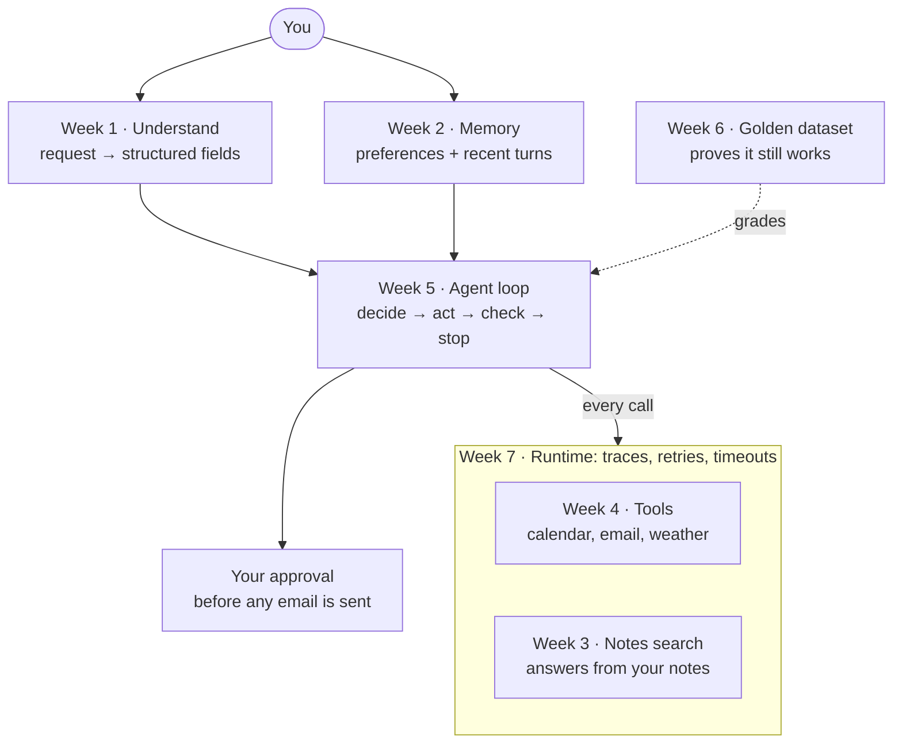

# Week 1 · Handout — Mini Muse

> Week 1 handout for the circle. The editable version is a Claude doc; this copy is kept in the repo.

## Our goal: build Mini Muse together

Over the next 8 weeks, the circle builds one agent together: **Mini Muse**, a small personal assistant. By Week 8 it can read your calendar, book events without double-booking, draft emails to your contacts and wait for your OK before sending, check the weather, answer questions from your notes, and do quick math.

Each week's topic adds one component. Nothing is built in one big step, so by the end you can explain every part of the system because you added it yourself.

From Week 5, teams also work on their own projects. Mini Muse is the reference: your project should have the same components, so you can compare your design with Mini Muse's one piece at a time.

## The roadmap: one component per week

Each row is what Mini Muse can do once that week is done.

| Week | Topic | Mini Muse gains | Now it can handle |
| --- | --- | --- | --- |
| 1 | LLM fundamentals | **Understand:** turns a request into structured fields | "Book lunch with Maya Tuesday at noon" becomes date, time, people |
| 2 | Context engineering | **Memory:** saved preferences, recent turns, a summary of older ones | "I prefer mornings" … later: "make it an hour later" |
| 3 | RAG | **Knowledge:** searches your notes and cites them | "What did Jordan say about the offsite budget?" |
| 4 | Tool calling | **Tools:** calendar, contacts, email, weather, calculator | "What's the weather in Detroit?" |
| 5 | Agent engineering | **Agent loop:** plans, acts, checks, stops; asks before sending email | "Find a free slot and book yoga" |
| 6 | Evals | **Proof:** a golden dataset grades the real agent | Pass rates, and cases that pass only sometimes |
| 7 | Production | **Reliability:** tracing, retries, timeouts, a fallback model | A tool fails, and Mini Muse recovers or says so |
| 8 | System design | **Assembled:** everything in one assistant, plus your demo | All of the above, in one conversation |



The agent loop sits in the middle. It uses what Weeks 1 and 2 give it, works through the tools and notes search, sends every call through the Week 7 runtime, and checks with you before sending email.

## How the weekly labs work

Every week page in the lab app has a switch at the top with two parts:

- **Concept demo:** the week's lab on its own (the API playground, the RAG system, the weather assistant). Use it to learn the idea.
- **Build Mini Muse:** the same idea, added to Mini Muse. Use it to see where the idea fits in a real agent.

Week 8, the assembled assistant, has no week page. Open **Mini Muse · all weeks** in the sidebar to see it, or any other component.

**A fake world, so nothing real happens.** Mini Muse's tools act on a pretend calendar, two contacts (Maya and Jordan), an outbox, weather for three cities and five sample notes. Nothing is ever really booked or sent. In that world, "today" is Monday, October 26, 2026, so dates work out the same for everyone.

**No coding required to follow along.** You can do every exercise by clicking in the app. If you code, each week is one Python file in `mini_muse/` (for example `week1_understand.py`), and each one also runs from the terminal.

## Week 1: teach Mini Muse to understand a request

This week Mini Muse learns to read what you ask. One API call with **structured output** turns free text into fields that code can rely on:

```text
"Book lunch with Maya on Tuesday at noon"
  → intent: schedule · title: Lunch · date: 2026-10-27 · time: 12:00 · people: [Maya] · missing_info: []
```

**Do it:** open **Week 1 · Single API Call**, switch to **Build Mini Muse**, pick an example and click **Understand**. Then try your own requests:

- [ ] A relative date, like "Tuesday". It only resolves because today's date is sent with the request.
- [ ] A vague request, like "schedule a call with the team next week". Watch what lands in `missing_info`.
- [ ] Something Mini Muse can't do, like "book me a flight to Beijing". The intent should be `other`.
- [ ] Note the tokens and cost under the answer. How does a longer request change them?

**Bring to the session:**

1. Why is `intent` a fixed list of choices rather than free text?
2. What would go wrong if the model filled in a time you never gave it?
3. Which fields would your own project's agent need to pull out of a request?

Also start the Week 1 concept lab (one API call, tokens, latency, cost) and a first sketch of your 8-week project's architecture.

## Where to find everything

| What | Where |
| --- | --- |
| Lab app (no setup needed) | [my-llm-playground on Streamlit](https://my-llm-playground-bvapyfhmkp7xn5ji9raank.streamlit.app/) |
| Code and notes | [lngsa1234/my-llm-playground](https://github.com/lngsa1234/my-llm-playground) on GitHub |
| Week-by-week Mini Muse guide | [Mini Muse guide](../mini-muse.md) |
| Program Guide | [Program Guide](../program-guide.md) |
| Mini Muse code | [`mini_muse/`](../../mini_muse/), one file per week |

**The hosted lab app runs on Ling's API key for now**, so you can start right away with no setup. Each Mini Muse run costs a fraction of a cent with the default model, `gpt-5.4-mini`.

**To use your own key**, fork the repository to your GitHub account and run your copy:

1. Fork [lngsa1234/my-llm-playground](https://github.com/lngsa1234/my-llm-playground) and clone your fork.
2. Run `pip install -r requirements.txt`.
3. Copy `.env.example` to `.env` and add your own OpenAI API key.
4. Run `streamlit run app.py`. To host it, deploy your fork on Streamlit Community Cloud and put the key in the app's Secrets as `OPENAI_API_KEY`.

Your fork is also where you build your own version of Mini Muse and your team project.
