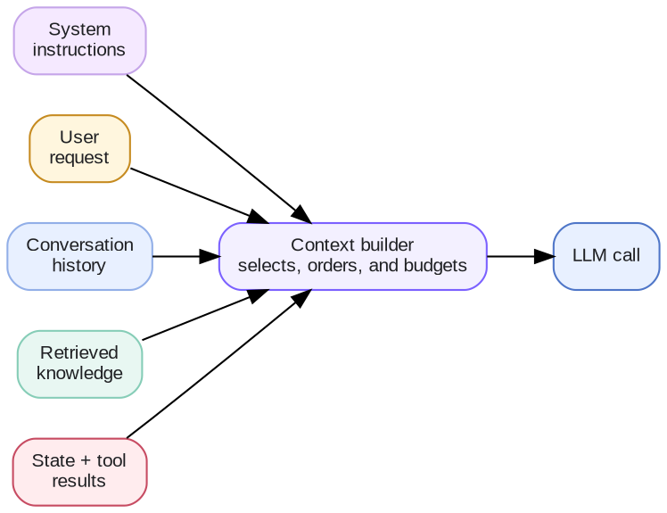
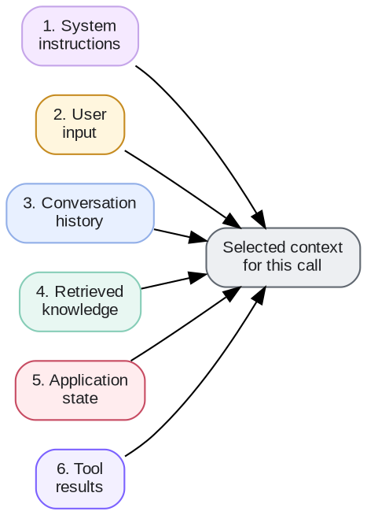
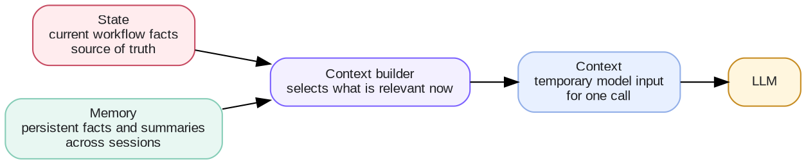
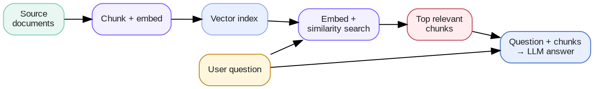

# Week 2 · Context Engineering — Concepts

Context engineering is one of the foundational disciplines of building reliable LLM applications and AI agents. It determines what information an AI model receives, how that information is organized, and how it changes as the application runs.

This knowledge base is designed for your AI PM / AI Engineer learning circle. It starts with the fundamentals, then connects them to practical system design, memory, retrieval, and evaluation.

## 1. What is context engineering?

Context engineering is the systematic process of selecting, constructing, managing, and optimizing the information provided to an LLM so it can perform a task effectively.

An LLM application typically does more than send a user message to a model. It may assemble instructions, conversation history, retrieved documents, application state, and tool results into a model request.



> 🎯 **The core engineering question is:**
>
> What does the model need to know right now to perform the next step accurately, efficiently, and safely?

## 2. The essential concepts

These terms form the vocabulary of context engineering.

| Concept | Definition |
| --- | --- |
| **Token** | A unit of information processed by the model, such as a word fragment or punctuation. |
| **Context** | The information available to the model for a particular inference. |
| **Context window** | The model's maximum supported context capacity, measured in tokens. |
| **Prompt** | The instructions and input provided to the model. |
| **Context builder** | Application logic that assembles the information for a model call. |
| **State** | Structured information about the application's current situation. |
| **Memory** | Information retained outside the current model call for future use. |
| **Retrieval** | Finding relevant information from external sources. |
| **RAG** | Retrieval-Augmented Generation: using retrieved information to support model generation. |
| **Compaction** | Compressing accumulated context while preserving important information. |
| **Context rot** | Degradation in the model's ability to use information effectively as context grows. |

> 💡 A particularly important distinction is that the context window is a capacity limit, not a memory system. A larger window allows more information to be processed, but does not guarantee that every detail will be used accurately.

## 3. Context vs. tokens vs. context window

Think of an LLM as a processor that receives an input sequence.


In this example, the model has a 128K-token capacity. The application allocates 80K tokens for input and anticipated output, leaving 48K unallocated. Actual accounting depends on the model and API, including any internal token usage.

### Does the model remember previous API calls?

**Not automatically.**

Consider three calls to a typical stateless model interface:

```text
Call 1:
User: My project is called Engineering Studio.
Model: Understood.

Call 2:
User: We have four agent roles.
Model: Understood.

Call 3:
User: What is my project called?
```

If Call 3 includes only the last question, the model does not have the project name available from the earlier calls.

The application needs to supply the relevant information again, whether through conversation history, a stored summary, or another memory mechanism. Some APIs offer server-managed conversation state, but that is still context management provided by the application or service, rather than permanent learning by the model.

## 4. Prompt engineering vs. context engineering

Prompt engineering is part of context engineering, but the two operate at different scopes.

| Dimension | Prompt engineering | Context engineering |
| --- | --- | --- |
| **Primary question** | How should I instruct the model? | What should the model know? |
| **Focus** | Wording, structure, examples | Selection, retrieval, memory, history |
| **Typical scope** | A prompt or template | The entire model input |
| **Runtime behavior** | Often relatively static | Often dynamically updated |
| **Example** | "Return valid JSON." | Retrieve the relevant API contract and recent test results. |

Anthropic describes context engineering as extending prompt engineering to the full information available during inference, particularly in multi-step agents.

For your engineering platform, a prompt might say:

> Review the proposed API change for backward compatibility.

The context builder must then provide the current API specification, proposed change, dependent interfaces, versioning policy, and relevant test results. Without those inputs, a well-written prompt cannot produce a grounded compatibility assessment.

## 5. The six main components of context



Not every request needs all six components. The context builder should include only what is relevant and authorized for the current task.

## 6. State vs. context vs. memory

These three concepts are related but should not be treated as interchangeable.



For example, your engineering agent may store this state:

```json
{
  "task_id": "ENG-102",
  "stage": "QA",
  "implementation_complete": true,
  "tests_passed": false,
  "blocking_issue": "API response mismatch"
}
```

The application does not need to pass its entire database to the model. It can extract the relevant fields and combine them with the failed test and API specification.

> 🔎 **State is the source of truth for workflow progress; context is the information selected for a particular model call.**

## 7. Core context engineering techniques

These are the principal techniques to learn and experiment with. Some solve relevance problems, others solve context-size, cost, or continuity problems.

1. **Context filtering** — Remove irrelevant information
2. **Truncation** — Enforce a context limit
3. **Summarization** — Reduce context size
4. **Compaction** — Maintain long-running continuity
5. **RAG** — Bring external knowledge into context
6. **Memory management** — Preserve information across sessions
7. **Context routing** — Give different tasks appropriate context
8. **Just-in-time retrieval** — Load information only when needed
9. **Prompt caching** — Reduce repeated processing cost
10. **Context isolation** — Avoid unrelated information crossing task boundaries

Anthropic's guidance highlights compaction, structured note-taking, just-in-time retrieval, and sub-agent isolation for long-running agents. OpenAI also documents prompt caching as a way to reduce repeated input processing.

## 8. Retrieval-Augmented Generation (RAG)

RAG is an important context engineering technique, but context engineering is broader than RAG.

RAG allows an application to retrieve relevant information from an external knowledge source and include it in the model's input.



This illustrates embedding-based RAG. Other implementations can use keyword search, hybrid search, direct database queries, or tool-based retrieval.

### When should you use RAG?

| Scenario | RAG needed? |
| --- | --- |
| **General explanation of Python syntax** | Usually not |
| **Answer a question about an internal product specification** | Often yes |
| **Find a bug in a large codebase** | Retrieval or code-search tools are useful |
| **Check the current task's workflow status** | Query application state instead |
| **Calculate a known mathematical formula** | Usually not |
| **Compare an API change against existing interface contracts** | Often yes |

> 🧭 **The important principle is to choose the appropriate source of truth.** RAG should not replace direct queries to structured systems when exact, current values are needed.

## 9. Context management across multiple turns

Context engineering becomes more important when a conversation or agent workflow continues for many steps.

### Context lifecycle

1. **Initialize** — Load task instructions and essential project information.
2. **Retrieve** — Obtain additional information required for the current step.
3. **Execute** — Call the model and, where appropriate, execute tools.
4. **Update** — Persist new decisions, findings, and task progress.
5. **Compact** — Compress or prune accumulated context when appropriate.
6. **Continue** — Build fresh context for the next step or agent.

A useful pattern for your engineering platform is to maintain a structured handoff record rather than passing the entire conversation from the PM agent to the software engineer and QA agent.

For example, the next agent can receive this record and retrieve detailed artifacts as needed.

```json
{
  "task": "Implement user authentication",
  "requirements": ["REQ-101", "REQ-102"],
  "decisions": ["Use existing authentication service"],
  "completed": ["API implementation", "Unit tests"],
  "pending": ["Integration tests"],
  "artifacts": ["auth-spec.md", "test-results.json"]
}
```

## 10. How to evaluate context engineering

A technique should not be selected solely because it reduces token usage. You need to measure whether it preserves or improves task performance.

| Metric | What it measures | Example signal |
| --- | --- | --- |
| Task success | Whether the outcome meets the task requirement | Correct answers ÷ evaluated answers |
| Groundedness | Whether claims are supported by supplied sources | Citation or evidence check |
| Context size | Tokens sent in the model input | Input-token count |
| Cost | Resource use per completed task | Input + output token cost |
| Latency | Time to a usable result | End-to-end seconds |
| Retrieval quality | Whether useful evidence was selected | Recall@K or judged relevance |

Correct answers divided by evaluated answers. Requires a reference answer or reliable grading rubric.

### Example: Comparing context strategies

The following results are hypothetical, illustrating how to design an experiment rather than reporting a real benchmark.

| Illustrative strategy | Task quality | Input tokens | Latency | Trade-off |
| --- | --- | --- | --- | --- |
| Full conversation history | High at first; can degrade as it grows | High | Higher | Simple, but costly and noisy |
| Summary + recent turns | Often stable | Medium | Medium | Depends on summary quality |
| Retrieval of top relevant chunks | High when retrieval is accurate | Low–medium | Medium | Requires an index and evaluation |

For a fair experiment, keep the dataset, model, instructions, and evaluation rubric fixed while changing the context strategy. Repeat tests where model outputs vary, and measure cost and latency alongside quality.

## 11. Common failure modes

| Failure | What happens | Possible mitigation |
| --- | --- | --- |
| **Context overflow** | Input exceeds supported capacity | Token budgeting, compaction |
| **Context rot** | Important details become difficult to use | Filtering, retrieval, testing |
| **Lost-in-the-middle** | Relevant information is overlooked in long inputs | Reorder and shorten context |
| **Stale context** | Old facts conflict with current information | Freshness checks, source timestamps |
| **Context contamination** | Irrelevant or incorrect information affects output | Source filtering and validation |
| **Memory drift** | Summaries accumulate incorrect assumptions | Preserve source references, verify updates |
| **Prompt injection** | Retrieved content attempts to override instructions | Enforce trust boundaries and tool permissions |
| **Handoff information loss** | The next agent lacks important decisions | Structured handoff contracts |

> 🛡️ Context quality includes not just relevance but also provenance, freshness, trust, and completeness.
