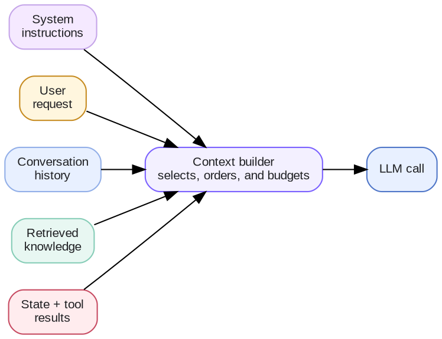

# Week 2 · Context Engineering — Concepts

## At a glance

| Learn | Build | Key terms | Watch for |
| --- | --- | --- | --- |
| How to choose what the model sees on each call | A context builder that picks the right messages and facts for a question | Context, context window, history, summary, retrieval | More context is not always better: it costs more and can bury the important details |

Week 1 showed that an LLM has no memory between calls and only knows what you send it. This week is about deciding **what to send**. For short definitions of any term, see the **Glossary**.

## 1. What is context engineering?

**Context** is everything the model sees on one call: the instructions, the user's question, and any extra information your application adds. **Context engineering** is the work of choosing that information: what to include, what to leave out, and how to arrange it.

A simple chatbot just sends the user's message. A real application usually gathers several kinds of information and assembles them into one request:

The piece of code that does this assembly is often called a **context builder**. Before every call it asks one question:

> 🎯 **What does the model need to know right now to do this step well?**

Prompt engineering, which is about *how you word* the instructions, is one part of this. Context engineering covers *everything* the model receives.

## 2. Why do we need context engineering?

Imagine a personal assistant you have been chatting with all week. On Monday you told it "I'm vegetarian." On Friday you ask: "Suggest a dinner recipe."

Whether it suggests a vegetarian dish depends entirely on what the application sends with Friday's question. Several things can go wrong:

| Problem | What happens in the example |
| --- | --- |
| **Too little context** | Only Friday's question is sent. The model does not know you are vegetarian and suggests chicken. |
| **Too much context** | The whole week of chat is sent. It works, but every call is slow and expensive, and it gets worse every day. |
| **Buried context** | The key fact is somewhere in the middle of hundreds of messages. Models tend to overlook details there, so it may still suggest chicken. |
| **Wrong or stale context** | An old message says "I'm trying vegetarian this month", but you have since changed your mind. The model follows the outdated fact. |
| **No room left** | Every model has a maximum it can read at once, called the **context window**. A long history eventually no longer fits. |

A larger context window helps, but it is a size limit, not a memory. Fitting more text in does not guarantee the model will use every detail well. Good context engineering sends **the right information, not the most information**.

## 3. How do we implement context engineering?

### Step 1: Know what you can include

A request can draw on six kinds of information. Most calls need only some of them.

| Ingredient | Example from the assistant |
| --- | --- |
| **Instructions** | "You are a helpful personal assistant. Keep answers short." |
| **The user's question** | "Suggest a dinner recipe." |
| **Conversation history** | The last few messages of today's chat |
| **Saved facts (memory)** | "Vegetarian", "Lives in Detroit" |
| **Retrieved information** | A recipe pulled from a recipe collection |
| **Current state and tool results** | Today's date, or what is in the user's grocery list |

### Step 2: Choose a strategy for history

History is usually the part that grows fastest. These are the common strategies, from simplest to smartest. This week's lab lets you try each one on the same question.

| Strategy | What it sends | Good for | Weakness |
| --- | --- | --- | --- |
| **No history** (baseline) | Only the current question | One-off questions | Forgets everything |
| **Full history** | Every earlier message | Short conversations | Slow and costly as it grows; key facts get buried |
| **Recent window** | Only the last few messages | Chats where only recent turns matter | Forgets older facts, like "I'm vegetarian" from Monday |
| **Summary + recent** | A short summary of the older chat, plus the last few messages | Long conversations | Only as good as the summary |
| **Retrieval** (keyword search) | Only the earlier messages that relate to the question | Long histories with scattered facts | Can miss a fact if the search is poor |

### Step 3: Keep important facts outside the chat

Do not rely on the chat log to remember things that matter. Save them separately:

- **Memory:** lasting facts about the user, such as "vegetarian", saved once and added to the request when relevant.
- **State:** the current progress of a task, such as which step a workflow is on, stored as structured data your code can read.

Your code then picks only the fields the model needs for this step, instead of sending everything.

### Step 4: Stay within a budget

Set a rough limit on how many tokens each request may use, and fill it in priority order: instructions and the question first, then key facts, then history and retrieved information. If you run out of room, summarize or drop the least useful parts.

When you need information from documents, such as a recipe collection or company files, the main technique is **RAG** (retrieval-augmented generation), the topic of Week 3.

## 4. How do we evaluate context engineering?

A strategy that uses fewer tokens is only better if the answers stay good. To compare strategies fairly, measure the same few things each time:

| What to measure | Question it answers |
| --- | --- |
| **Answer quality** | Did the answer use the facts it needed? (Did it remember "vegetarian"?) |
| **Tokens sent** | How much did we send? This drives cost. |
| **Latency** | How long did the answer take? |
| **Grounding** | Is the answer based on the information we sent, rather than invented? |

To run a fair comparison:

1. Write a small set of test questions, each with the facts a good answer must include.
2. Keep everything else fixed: same model, same instructions, same questions.
3. Change **only** the context strategy.
4. Run each test more than once, because model answers vary.
5. Compare quality, tokens, and latency side by side.

The results usually look something like this (illustrative, not a real benchmark):

| Strategy | Answer quality | Tokens sent | Speed |
| --- | --- | --- | --- |
| Full history | Good at first, worse as the chat grows | High | Slower |
| Recent window | Poor when the key fact is old | Low | Fast |
| Summary + recent | Usually steady | Medium | Medium |
| Retrieval | Good when the search finds the right messages | Low to medium | Medium |

There is rarely one best strategy. The right choice depends on how long your conversations are, where the important facts live, and how much you can spend per call. This week's lab gives you real numbers for your own questions.

## References

- [OpenAI Cookbook — Context engineering with session memory](https://developers.openai.com/cookbook/examples/agents_sdk/session_memory)
- [OpenAI API — Prompt engineering](https://developers.openai.com/api/docs/guides/prompt-engineering)
- [OpenAI API — Prompt caching](https://developers.openai.com/api/docs/guides/prompt-caching)
- [OWASP — LLM Prompt Injection Prevention Cheat Sheet](https://cheatsheetseries.owasp.org/cheatsheets/LLM_Prompt_Injection_Prevention_Cheat_Sheet.html)
- [Anthropic — Effective context engineering for AI agents](https://www.anthropic.com/engineering/effective-context-engineering-for-ai-agents)
