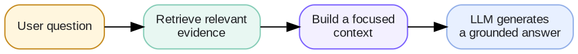
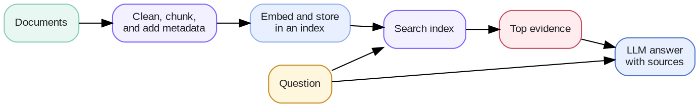

# Week 3 · RAG — Concepts

## At a glance

| Learn | Build | Key terms | Watch for |
| --- | --- | --- | --- |
| How to let a model answer from your own documents | A small search over company documents that answers with sources | Chunk, embedding, Top-K, recall, precision, F1 | If the search misses the right passage, the answer will be wrong however good the model is |

Week 1 showed that a model does not know your private information. Week 2 showed how to choose what goes into each call. This week puts the two together: **find the right passage in your documents, then let the model answer from it.** For short definitions of any term, see the **Glossary**.

## 1. What is RAG?

**RAG** stands for *retrieval-augmented generation*. In plain terms: **look it up first, then answer.**

Before the model answers, your application searches a collection of documents, picks the few passages most related to the question, and sends them to the model along with the question. The model then writes its answer from those passages.



An everyday comparison is an open-book exam. The model is the student; RAG hands it the right page of the textbook before it answers. It does not teach the model anything permanently. The passages are used for that one call only.

## 2. Why do we need RAG?

Throughout this page we use the lab's example: **NovaTech**, a fictional company with ten policy documents (pricing, refunds, remote work, vacation, and so on). An employee asks:

> "How many remote days are employees allowed?"

A plain LLM has never seen NovaTech's policies. It can only guess, and it may guess confidently. With RAG, the app finds the remote-work policy, sends the relevant paragraph, and the model answers "three days per week", citing the document.

RAG is the right tool when the information is:

- **Private**, such as company policies, your notes, or support tickets.
- **Changing**, such as prices or product features. Update the documents and the answers update too; no retraining.
- **Too large to send every time.** You cannot paste all ten policies, let alone thousands of pages, into every call.
- **Something you need to prove.** Answers can point to the exact source.

RAG is not always the answer:

| You need to… | Better approach |
| --- | --- |
| Tell the model how to behave or format its answer | Instructions in the prompt (Week 1) |
| Give it a few known facts for one task | Put them directly in the context (Week 2) |
| Look up an exact, current value, such as an order status | Query the database or API directly (Week 4) |
| Search a large or changing set of documents | **RAG** |

## 3. How do we implement RAG?

RAG has two parts. **Preparing the documents** happens once, and again whenever they change. **Answering a question** happens every time a user asks.



### Part 1: Prepare the documents

1. **Collect** the documents you trust, such as the ten NovaTech policies.
2. **Split** them into small passages called **chunks**, each a paragraph or a short section. Small chunks let the search return just the relevant part instead of a whole document.
3. **Turn each chunk into an embedding**: a list of numbers that captures its meaning, so passages about similar things end up with similar numbers.
4. **Store** the chunks, their embeddings, and where each came from (document name, section) in a searchable index.

How you split matters more than it seems. If a chunk cuts a sentence in half, the fact may end up split across two chunks and neither one makes sense alone. Splitting along headings or paragraphs usually works better than cutting every fixed number of characters.

### Part 2: Answer a question

1. **Search** the index for the chunks most related to the question.
2. **Keep the top few**, called **Top-K** (for example, the top 5). More is not always better: extra chunks add cost and can bury the useful one.
3. **Build the request**: the question, the chosen chunks, and clear instructions.
4. **Generate** the answer, with the sources it used.

There are three common ways to search, and this week's lab lets you try each:

| Search method | How it works | Good at | Weak at |
| --- | --- | --- | --- |
| **Keywords** | Finds chunks containing the same words | Exact names, numbers, product codes | Different wording: "end my subscription" vs. "cancel" |
| **Meaning** (semantic) | Compares embeddings to find similar meaning | Paraphrases and related ideas | Exact codes; can return something similar but wrong |
| **Hybrid** | Combines both | Most real questions | Slightly more work to set up and tune |

The instructions matter too. A typical RAG prompt says:

```text
Answer using only the sources below.
If the sources do not contain the answer, say you don't know.
Name the source for each fact.
```

The "say you don't know" line is important. Without it, a model that was handed the wrong chunks will often invent a plausible answer instead.

## 4. How do we evaluate RAG?

A RAG answer can fail in two different places, so check them separately:

1. **Did the search find the right passage?** (retrieval)
2. **Given that passage, did the model answer correctly and stick to it?** (generation)

When an answer is wrong, always ask the first question first. If the right passage was never found, no prompt or model change can fix the answer; the fix is in how documents are split or searched.

| If the right passage was **not** found | If it **was** found but the answer is still wrong |
| --- | --- |
| Try a different chunking strategy, search method, or a larger Top-K, and check the document is in the index at all. | Tighten the instructions, reduce the number of chunks, or check whether two sources disagree. |

### Metrics for the search (retrieval)

Retrieval metrics compare the chunks that were found with the document that actually holds the answer. For our question, that is the remote-work policy. Suppose Top-K is 5 and the search returns five chunks: two from the remote-work policy and three from other documents.

| Metric | Question it answers | Formula | Example |
| --- | --- | --- | --- |
| **Recall@K** | Did we find what we needed? | needed documents found ÷ needed documents | 1 ÷ 1 = **100%** |
| **Precision@K** | How much of what we found was useful? | useful chunks ÷ chunks returned (K) | 2 ÷ 5 = **40%** |

Recall@K matters most. If it is low, the answer cannot be right, because the model never saw the evidence. Precision@K tells you how much noise came along. Low precision wastes tokens and can distract the model, so it is a reason to try a smaller Top-K or a better search method.

The two pull against each other. Raising K usually raises recall (more chances to find the passage) and lowers precision (more unrelated chunks).

### Metrics for the answer (generation)

Answer metrics compare the model's answer with the expected answer, here "three days per week". Both ignore capital letters and punctuation.

| Metric | How it works | "Three days per week." | "Employees can work remotely three days per week." |
| --- | --- | --- | --- |
| **Exact match** | 100% only if the answer is exactly the expected words | **100%** | **0%** |
| **F1** | Gives partial credit for overlapping words | **100%** | **67%** |

**F1** combines two numbers, here counted in words:

- **Precision**: how many of the answer's words appear in the expected answer. The longer answer has 8 words, 4 of them matching: 4 ÷ 8 = 50%.
- **Recall**: how many of the expected words appear in the answer. All 4 do: 4 ÷ 4 = 100%.
- **F1** = 2 × precision × recall ÷ (precision + recall) = 2 × 0.5 × 1 ÷ 1.5 = **67%**.

F1 is high only when both precision and recall are high. That is why it is a popular single score: an answer cannot score well just by being long (which keeps recall high) or just by being short (which keeps precision high).

These scores are useful for comparing many runs quickly, but they only count matching words. The wrong answer "Two days per week." still scores 75% F1, because three of its four words match. So also check:

| Check | Question it answers |
| --- | --- |
| **Faithfulness** | Does every claim come from the retrieved passages, rather than being invented? |
| **Says "I don't know" when it should** | For a question the documents cannot answer, does it decline instead of guessing? |
| **Cost and latency** | How many tokens and how much time does each answer take? |

The lab reports Recall@K, Precision@K, exact match, and F1 for every test question, so you can see these numbers move as you change settings.

To compare settings fairly, use a fixed set of test questions, each with the expected answer and the document that contains it, as the lab does for NovaTech. Then change **one** thing at a time (chunking, search method, or Top-K) and compare the results.

## References

- [OpenAI API — File search](https://developers.openai.com/api/docs/guides/tools-file-search)
- [OpenAI API — Prompt engineering](https://developers.openai.com/api/docs/guides/prompt-engineering)
- [OpenAI API — Vector embeddings](https://developers.openai.com/api/docs/guides/embeddings)
- [Retrieval-Augmented Generation for Knowledge-Intensive NLP Tasks](https://arxiv.org/abs/2005.11401)
- [Hugging Face — RAG evaluation cookbook](https://huggingface.co/learn/cookbook/en/rag_evaluation)
