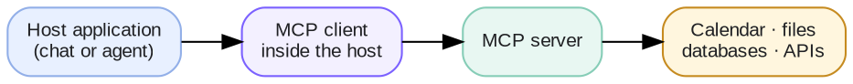
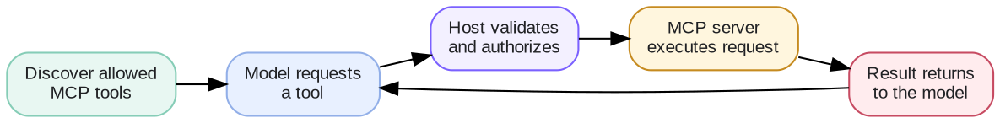

# Week 4 · Tool Calling — Concepts: MCP

## At a glance

| Learn | Build | Key terms | Watch for |
| --- | --- | --- | --- |
| Use a common protocol to connect AI applications with tools and data | An MCP client or server integration | MCP, tools, resources, prompts, client, server | MCP standardizes connections; it does not replace authorization or tool safety |

## 1. What is MCP?

**MCP (Model Context Protocol)** is an open protocol for connecting an AI application to external capabilities in a consistent way. It lets an application discover and use tools, read resources, and load reusable prompts from an MCP server.

MCP is infrastructure—not a model, an agent framework, or a permission system. It standardizes the connection; your application remains responsible for who may connect and what may happen.

## 2. The main pieces

| Piece | Responsibility |
| --- | --- |
| Host | The AI product that manages the user experience and policy |
| MCP client | Connects to one or more servers on the host's behalf |
| MCP server | Advertises capabilities and handles requests |
| Tool | A callable operation, such as `search_docs` or `create_ticket` |
| Resource | Readable data or content identified by a URI |
| Prompt | A reusable interaction template supplied by a server |

An MCP server may wrap an existing API, database, local file system, or internal service. MCP does not replace those systems; it offers a consistent interface to them.

## 3. MCP and tool calling work together

Tool calling and MCP solve different parts of the problem:

| Capability | Tool calling | MCP |
| --- | --- | --- |
| Lets a model request an action | Yes | Can provide the tool definition |
| Connects an app to external capabilities | Not by itself | Yes |
| Defines a common discovery protocol | No | Yes |
| Handles authorization and approvals automatically | No | No |

In a typical flow, the host connects to an MCP server, discovers its tools, gives selected tool schemas to the model, validates a requested call, executes it through the MCP client, and returns the result to the model.

## 4. Security and trust boundaries

Treat every MCP server as an external dependency, even when it is internal.

- Connect only to servers you trust and expect.
- Give each connection the minimum credentials and scopes needed.
- Filter tools by user, tenant, and task before exposing them to a model.
- Validate all tool inputs on the server side.
- Require confirmation for consequential actions such as sending, purchasing, deleting, or publishing.
- Log the server, tool, arguments, result, and approval decision without recording unnecessary sensitive data.

The host—not the LLM—should enforce these rules. A tool description can influence the model; it cannot grant authority.

## 5. MCP, RAG, and direct APIs

| Need | Good fit |
| --- | --- |
| Search a changing document collection | RAG or a search tool, possibly exposed through MCP |
| Retrieve an exact current order status | A direct API query or an MCP tool that wraps it |
| Reuse an integration across several AI hosts | An MCP server |
| Make one private backend call in one application | A direct API may be simpler |

MCP is valuable when standard discovery and reuse outweigh the overhead of operating another interface. It is not required for every integration.

## 6. Evaluate an MCP integration

| Area | What to check |
| --- | --- |
| Discovery | Only expected tools, resources, and prompts are exposed |
| Correctness | Calls return valid, useful results and errors |
| Security | Authentication, authorization, and tenant isolation work |
| Reliability | Timeouts, retries, and reconnect behavior are understood |
| Agent behavior | The host offers the right capabilities and handles failures safely |

Test server downtime, malformed results, revoked access, overly broad tools, and prompt-injection attempts in retrieved content.

## 7. Core mental model

**MCP is the standardized connection. Tool calling is the model's request. The host application remains the control point.**

That distinction keeps architecture discussions clear: MCP helps an agent find and use capabilities, while the host decides which capabilities are available and when they may run.
