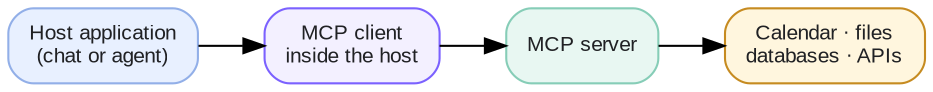
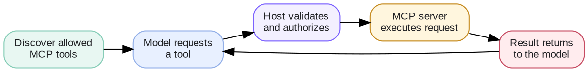

# Week 4 · Tool Calling — Concepts: MCP

## At a glance

| Learn | Build | Key terms | Watch for |
| --- | --- | --- | --- |
| How to share tools between AI applications using one standard | The weather tools served by an MCP server and used by an MCP client | MCP, server, client, host, tools, resources | MCP standardizes the connection; it does not decide what is safe to run |

This page builds on *Week 4 · Tool Calling*. For short definitions of any term, see the **Glossary**.

## 1. What is MCP?

**MCP** (Model Context Protocol) is an open standard for connecting AI applications to tools and data. Think of it as **USB-C for AI tools**: build a tool once as an MCP server, and any application that speaks MCP can plug into it.

Without MCP, every application wires up every tool its own way. With MCP, a tool provider publishes one server, and chat apps, coding assistants, and your own agents can all discover and use the same tools.



The pieces:

| Piece | What it is | In the lab |
| --- | --- | --- |
| **Host** | The AI application the user works in | The weather assistant |
| **MCP client** | The part of the host that talks to servers | `mcp_client_demo.py` |
| **MCP server** | A program that offers tools and data | `weather_mcp_server.py` |
| **Tools** | Functions the model can ask to run | `get_weather`, `get_weekend_forecast` |
| **Resources** | Data the application can read, such as files or records | (not used in the lab) |
| **Prompts** | Reusable instruction templates a server can offer | (not used in the lab) |

## 2. Why do we need MCP?

Tool calling already lets a model use tools, so why add a protocol? Because of **reuse**.

Imagine five AI applications that each need calendar, email, and file access. Wired by hand, that is fifteen separate integrations to build and maintain. With MCP, the calendar, email, and file providers each publish one server, and every application connects to all three the same way.

| Without MCP | With MCP |
| --- | --- |
| Each app writes its own code for each tool | Build a tool once as a server; any MCP app can use it |
| Tools are hard-coded into the app | The app **discovers** what tools a server offers when it connects |
| Changing a tool means updating every app | Update the server; connected apps see the change |

This is why many AI products now let you "connect" outside services: under the hood, many of those connections are MCP servers.

MCP is not always necessary. For one private call inside one application, a plain function, as in the first half of the lab, is simpler.

## 3. How do we implement MCP?

MCP sits *under* tool calling. The model still asks for a tool exactly as before; only the way your application reaches the tool changes:

```text
Direct:  model → tool request → your app → Python function → weather API
MCP:     model → tool request → your app → MCP client → MCP server → weather API
```



The steps in the lab:

1. **Start the server.** `weather_mcp_server.py` wraps the same weather functions and offers them as MCP tools.
2. **Connect and discover.** The client connects and asks the server which tools it has. It gets back the names, descriptions, and input schemas.
3. **Give the tools to the model.** The client passes those schemas to the model, just like the hand-written schemas in direct tool calling.
4. **Route the call.** When the model asks for `get_weather("Detroit")`, the client sends that request to the server, which runs it and returns the result.
5. **Answer.** The result goes back to the model, which writes its reply.

Staying safe works the same way as with direct tools, with one addition: an MCP server is outside code your application chose to trust. So:

- **Connect only to servers you trust**, and give each one only the access it needs.
- **Offer the model only the tools this user and task need**, not everything a server provides.
- **Still check inputs and ask a person** before consequential actions. MCP does not do this for you.
- **Treat tool results and tool descriptions as information, not instructions**, since a malicious server could try to slip in commands.

## 4. How do we evaluate an MCP integration?

Everything from evaluating tool calling still applies: tool selection, arguments, execution, and task success. A simple first check is to run the same test questions against both versions in the lab. The answers should match, because MCP changes how tools are reached, not what they do.

MCP adds a few things of its own to check:

| Area | What to check |
| --- | --- |
| **Discovery** | The client sees exactly the tools you expect, with clear descriptions, and nothing extra |
| **Same results** | Direct and MCP versions give the same answers to the same questions |
| **Failures** | What happens if the server is down, slow, or returns something malformed? The model should report a problem, not invent an answer |
| **Access** | The server rejects requests it should not allow, and credentials stay limited to what is needed |
| **Overhead** | How much extra time the MCP hop adds per call |

## References

- [Model Context Protocol — Specification](https://modelcontextprotocol.io/specification/)
- [OpenAI API — Function calling](https://developers.openai.com/api/docs/guides/function-calling)
- [MCP TypeScript SDK documentation](https://ts.sdk.modelcontextprotocol.io/v2/)
- [OWASP — AI Agent Security Cheat Sheet](https://cheatsheetseries.owasp.org/cheatsheets/AI_Agent_Security_Cheat_Sheet.html)
- [MCP — Getting started](https://modelcontextprotocol.io/docs/getting-started/intro)
