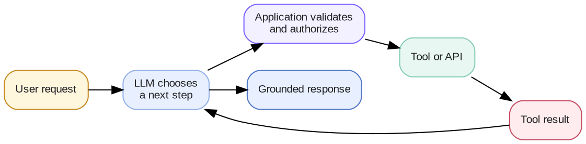

# Week 4 · Tool Calling — Concepts

## At a glance

| Learn | Build | Key terms | Watch for |
| --- | --- | --- | --- |
| How a model can use live data and take actions by asking your code to run functions | A weather assistant that looks up real, current weather | Tool, tool schema, arguments, tool result, approval | The model only *asks* for a tool; your application decides whether to run it |

So far the model has only read text you gave it. This week it gets to **ask for things**: current data from an API, a calculation, or an action in another system. For short definitions of any term, see the **Glossary**.

## 1. What is tool calling?

A **tool** is a function your application makes available to the model, such as "get the weather for a city" or "add an event to the calendar". **Tool calling** is how the model uses it.

The model cannot run code or reach the internet itself; it only produces text. So instead of answering, it can reply with a structured request: *"please run `get_weather` with `location = Detroit`"*. Your application checks the request, runs the function, and sends the result back. The model then writes its answer from that result.



Think of the model as a capable assistant who works only by message. It cannot open the weather app, but it can write you a note asking you to check, and then use what you tell it.

## 2. Why do we need tool calling?

Ask a plain LLM "What's the weather in Detroit right now?" and it can only guess, because its training data is months old and it has no way to look outside. With a weather tool, it asks for the real reading and answers from it.

Tools fill the gaps that a model cannot fill on its own:

| The model cannot… | Tool example |
| --- | --- |
| Know anything current | `get_weather(location)`, stock prices, today's news |
| Read your live systems | Check a calendar, look up an order status |
| Calculate reliably | A calculator or a spreadsheet function |
| Do things in the world | Send an email, create a ticket, book a meeting |

How this differs from the earlier weeks:

| You need… | Use |
| --- | --- |
| The model to explain or reason about something | A plain LLM call (Week 1) |
| Facts from your documents | RAG (Week 3) |
| A current, exact value or an action | **Tool calling** |

In fact, RAG can itself be offered as a tool: "search the policy documents" is just another function the model can ask for.

## 3. How do we implement tool calling?

### Step 1: Describe the tool

You give the model a short description of each tool: its name, what it is for, and what inputs it needs. This description is called the **tool schema**. Here is the lab's weather tool:

```json
{
  "name": "get_weather",
  "description": "Get the current weather for a city or location.",
  "parameters": {
    "type": "object",
    "properties": {
      "location": {"type": "string", "description": "City or location to retrieve weather for."}
    },
    "required": ["location"]
  }
}
```

The model decides whether to use a tool from its name and description alone, so write them carefully. Small, specific tools (`get_weather`, `get_weekend_forecast`) work much better than one vague `do_anything` tool.

### Step 2: Run the conversation loop

1. **Send** the user's question together with the tool schemas.
2. **The model replies** either with a normal answer or with a tool request, such as `get_weather(location="Detroit")`.
3. **Your application runs the tool** and gets a result, for example `{"location": "Detroit", "temperature_f": 41}`.
4. **Send the result back** to the model.
5. **The model answers**: "It's 41°F in Detroit right now."

Some questions need more than one call. "Which is warmer right now, Detroit or Miami?" needs two weather lookups before the model can compare. Always set a limit, such as five rounds, so a confused model cannot loop forever.

### Step 3: Keep your application in control

The model *proposes*; your application *decides*. Before running any tool request, your code should:

- **Check it is allowed** for this user and this task.
- **Check the inputs** are valid, such as a real location rather than an empty string.
- **Ask a person first** for anything consequential, such as sending a message, spending money, or deleting data.
- **Send back the real result, including errors.** If the city is not found, tell the model so it says so, rather than inventing a temperature.

Treat whatever a tool returns as information, not as instructions. A web page or document fetched by a tool might contain text like "ignore your rules", and the model must not obey it.

## 4. How do we evaluate tool calling?

A tool-using answer can go wrong at several points, so check each one. Write a set of test questions with the behavior you expect, like this one from the lab:

| Question | Expected behavior |
| --- | --- |
| "Explain humidity." | **No tool**: the model can answer this itself |
| "Weather in Detroit now?" | `get_weather("Detroit")` |
| "Should I plan an outdoor event in Detroit this weekend?" | `get_weekend_forecast("Detroit")`, not current weather |
| "Detroit vs. Miami right now?" | Two `get_weather` calls, then a comparison |
| "Weather in asdfghxyz?" | A tool call, then a polite "location not found", with no invented numbers |

Then measure:

| Metric | Question it answers | Formula |
| --- | --- | --- |
| **Tool-selection accuracy** | Did it pick the right tool, or correctly use none? | correct tool decisions ÷ test questions |
| **Argument accuracy** | Did it fill in the right inputs? | calls with the intended location ÷ tool calls |
| **Execution success** | Did the tool actually run? | successful runs ÷ attempted runs |
| **Task success** | Was the final answer right and honest? | correct, non-invented answers ÷ test questions |
| **Efficiency** | How many calls, how long, how much did it cost? | calls, seconds, and tokens per question |

These separate three different kinds of failure. A *tool-calling* failure means the model chose the wrong tool or inputs. An *execution* failure is a broken API or a timeout. A *task* failure is a bad final answer, such as a made-up temperature after the tool correctly returned "location not found". Each has a different fix.

For larger comparisons, public benchmarks such as the **Berkeley Function-Calling Leaderboard (BFCL)** test how well models choose tools and fill in arguments. See *Week 6 · Evals · Benchmarks*.

To share the same tools across many applications, there is a standard protocol called MCP. See *Week 4 · Tool Calling · MCP*.

## References

- [OpenAI API — Function calling](https://developers.openai.com/api/docs/guides/function-calling)
- [Model Context Protocol — Specification](https://modelcontextprotocol.io/specification/)
- [OWASP — AI Agent Security Cheat Sheet](https://cheatsheetseries.owasp.org/cheatsheets/AI_Agent_Security_Cheat_Sheet.html)
- [OWASP — LLM Prompt Injection Prevention Cheat Sheet](https://cheatsheetseries.owasp.org/cheatsheets/LLM_Prompt_Injection_Prevention_Cheat_Sheet.html)
- [Hugging Face Agents Course — Introduction](https://huggingface.co/learn/agents-course/en/unit1/introduction)
