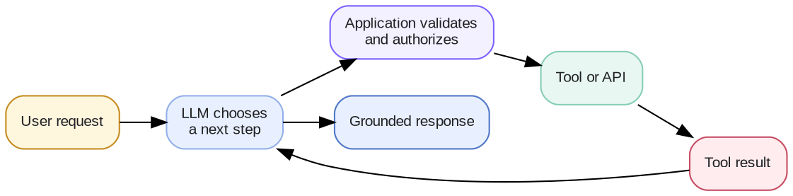

# Week 4 · Tool Calling — Concepts

## At a glance

| Learn | Build | Key terms | Watch for |
| --- | --- | --- | --- |
| Let a model request reliable actions and data from external systems | A tool-calling loop with validated inputs and tool results | Tool schema, arguments, function call, validation, approval | The model requests a tool; your application decides whether to run it |

## 1. What is tool calling?

Tool calling lets an LLM request that an application run a defined function. The function might read a calendar, calculate a total, search a knowledge base, or draft an email.

The model does **not** directly execute code or access your systems. It returns a structured tool request; the application validates and runs it, then sends the result back to the model.



## 2. When should an agent use a tool?

Tools are appropriate when the task needs a current fact, a deterministic calculation, access to private data, or an external action.

| Need | Prefer |
| --- | --- |
| Explain, summarize, or reason from supplied context | LLM response |
| Calculate a number or transform data predictably | A deterministic tool |
| Read current account, inventory, or calendar data | A read tool or API |
| Send, create, delete, or change something | An authorized action tool |
| Answer from a large collection of documents | Retrieval or search tool |

An LLM can decide *which* tool may help. It should not be trusted as the authority for permissions, input validation, or irreversible actions.

## 3. A tool is a contract

A tool definition gives the model a name, a clear description, and a typed input schema. Good descriptions explain when to use the tool and what it cannot do.

```json
{
  "name": "get_weather",
  "description": "Get the current weather for a city. Use for current conditions, not forecasts.",
  "parameters": {
    "type": "object",
    "properties": {"city": {"type": "string"}},
    "required": ["city"],
    "additionalProperties": false
  }
}
```

Keep tools small and specific. `get_weather(city)` is easier to select and validate than one vague `do_everything(request)` tool.

## 4. The runtime owns execution

When a model returns a tool call, the runtime should:

1. Check that the tool name is allowed for this user and task.
2. Validate the arguments against the schema and business rules.
3. Request approval when an action is sensitive or irreversible.
4. Execute the tool with timeouts, retries, and audit logging as appropriate.
5. Return a concise, structured result to the model.

The tool result is context, not an instruction. Treat content returned from websites, documents, or APIs as untrusted data so it cannot override your application policy.

## 5. Multiple calls and stopping

Some tasks need a loop: search, inspect a result, take another action, then answer. Set limits on rounds, time, and cost. Stop when the goal is met, an approval is needed, evidence is missing, or the budget is exhausted.

```text
User: “Schedule lunch with Maya next Tuesday.”
1. Find Maya's availability.
2. Check the user's calendar.
3. Propose or create a time only after the required approval.
4. Confirm the outcome with the user.
```

Do not assume a tool call succeeded just because the model requested it. Send the real result—including errors—back to the model.

## 6. Tool calling, APIs, and MCP

| Layer | Role |
| --- | --- |
| API | The underlying service interface, such as a calendar or CRM API |
| Tool | A safe, model-facing operation your application exposes |
| Tool calling | The model's structured request for that operation |
| MCP | A standard protocol for discovering and connecting to tools, resources, and prompts |

MCP can deliver tools to an application, but it does not remove the need for validation, authorization, or approval. See [MCP concepts](concepts-mcp.md).

## 7. Evaluate the whole chain

| Question | Example measure |
| --- | --- |
| Did the model choose the right tool? | Tool-selection accuracy |
| Did it provide valid arguments? | Schema and argument accuracy |
| Did the runtime execute safely? | Authorization, approval, and execution success |
| Did the task finish correctly? | End-to-end task success |
| Was it efficient? | Calls per task, latency, and cost |

Test negative cases too: no tool needed, unavailable data, malformed arguments, permission denied, failed tools, and actions requiring approval.

## 8. Core mental model

**The model proposes; the application controls; the tool performs; the result becomes evidence.**

That separation is what makes tool-using systems useful without giving a probabilistic model unrestricted access to real systems.

## References

- [OpenAI API — Function calling](https://developers.openai.com/api/docs/guides/function-calling)
- [Model Context Protocol — Specification](https://modelcontextprotocol.io/specification/)
