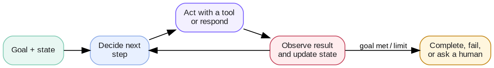

# Week 5 · Agent Engineering — Concepts

## At a glance

| Learn | Build | Key terms | Watch for |
| --- | --- | --- | --- |
| Design a multi-step system that observes, decides, acts, and tracks progress | A stateful workflow agent with defined transitions | State, workflow, routing, control loop, orchestration | Agents need stop conditions, budgets, and human approval paths |

## 1. What makes a system an agent?

An agent is an application that pursues a goal across multiple steps. It maintains state, chooses a next action, uses tools when needed, observes the result, and stops according to explicit rules.



Not every multi-step feature needs a model-driven agent. A fixed workflow is usually simpler when the paths and decisions are already known.

## 2. State, context, and memory

| Concept | Meaning | Example |
| --- | --- | --- |
| State | Structured facts about the current run | `stage="qa"`, `retry_count=1`, `tests_passed=false` |
| Context | Information sent to the model for this call | Current task, relevant test failure, permitted tools |
| Memory | Information kept beyond this run or call | User preference, previous decision, project note |

State is the source of truth for workflow progress. Keep it explicit and machine-readable; do not rely on a long conversation transcript to determine whether an action already happened.

```python
state = {
    "task": "Fix the API response mismatch",
    "stage": "investigate",
    "attempts": 0,
    "tool_results": [],
    "status": "in_progress",
}
```

## 3. Design the workflow first

A workflow defines stages, valid transitions, and terminal states. Make deterministic decisions in code; use an LLM only where judgment is needed.

```text
Request → Understand → Plan → Execute → Validate → Complete
                                ↘ Ask for approval / more information
                                ↘ Fail safely / hand off
```

Useful transition rules include: retry a transient failure once, stop after a fixed budget, never send or delete without approval, and finish only after a check confirms the outcome.

## 4. Routing

Routing answers: **what should happen next?** It can select a workflow stage, tool, retrieval step, or specialist.

| Route type | Best use |
| --- | --- |
| Deterministic rule | Known conditions: permission denied, test passed, retry limit reached |
| LLM router | Ambiguous intent or a choice requiring semantic judgment |
| Hybrid | Rules handle clear cases; the model handles the remainder |

Prefer rules for safety boundaries and known business logic. A model router should choose only from an allowed, well-described set of options.

## 5. Tools, validation, and approval

Every action should have an owner outside the model:

1. The model proposes an action.
2. The runtime validates the tool and arguments.
3. Policy checks authorization, budgets, and approval requirements.
4. The tool runs and returns an observable result.
5. State records what actually occurred.

Tool results are evidence, not instructions. Treat retrieved text and external responses as untrusted input.

## 6. Single agent before multi-agent

Use one agent with a clear workflow unless separate roles have genuinely different context, tools, permissions, or evaluation criteria.

| Add a specialist when | Keep one agent when |
| --- | --- |
| It needs isolated credentials, narrow context, or a dedicated quality gate | It is only a different step in the same workflow |
| A handoff can be represented with a clear contract | Passing context would add more complexity than value |

Each handoff should include inputs, allowed tools, expected outputs, and exit criteria. “PM agent → engineer agent → QA agent” is useful only when those contracts improve reliability.

## 7. Evaluate the workflow

Measure task success as well as behavior: correct route, valid tool sequence, state updates, approval handling, retries, and termination. Record a trace for every run so a failure can be diagnosed without guessing what the model saw or did.

**Core mental model:** the model proposes the next step; the workflow and runtime control what may happen.

## References

- [OpenAI API — Agents](https://developers.openai.com/api/docs/guides/agents)
- [OpenAI API — Function calling](https://developers.openai.com/api/docs/guides/function-calling)
