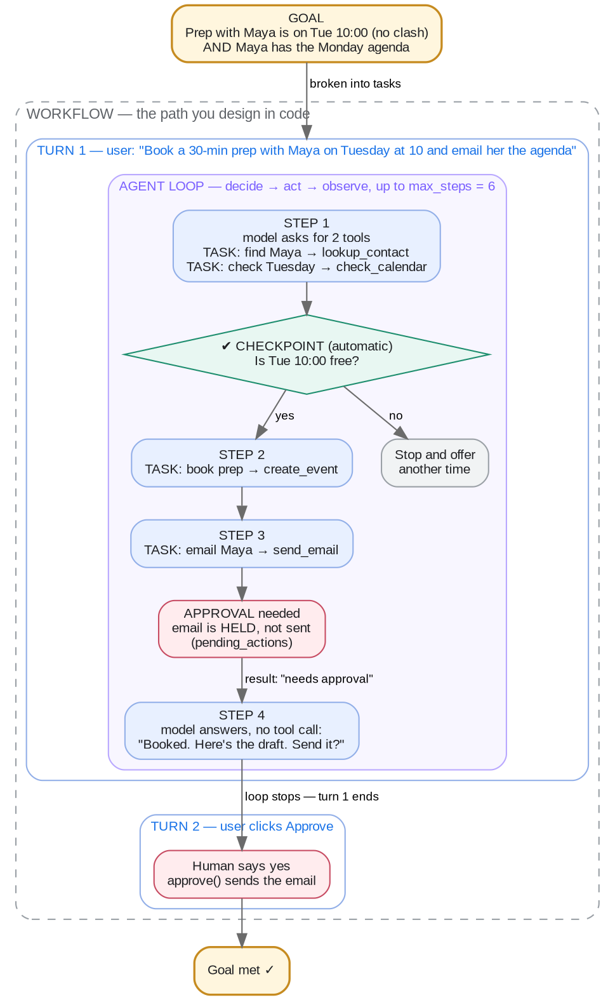

# Week 5 · Agent Engineering — Concepts

## At a glance

| Learn | Build | Key terms | Watch for |
| --- | --- | --- | --- |
| How an agent works through a request step by step, and how you keep it safe | Mini Muse's agent loop, with a step cap and approval before email | Goal, task, agent loop, step, turn · workflow, checkpoint, approval | Agents need stop conditions, budgets, and human approval paths |

## 1. One example for the whole page

You type this into Mini Muse:

> **"Book a 30-minute prep with Maya on Tuesday at 10 and email her the agenda."**

Everything on this page is explained with this one request. Follow it through the diagram first, then read what each label means.



Read it from the top:

1. **Goal.** What you want to be true at the end: the prep is booked without a clash, and Maya has the agenda.
2. **Turn 1.** Your message starts the first turn.
3. **Agent loop.** Mini Muse repeats *decide → act → observe*. Each pass is one **step**.
4. **Step 1.** The model asks for two tools at once: find Maya's email, and check Tuesday's calendar.
5. **Checkpoint.** Is Tuesday 10:00 free? If not, Mini Muse stops and offers another time. If yes, it continues.
6. **Step 2.** It books the prep.
7. **Step 3.** It asks to send the email, but sending is risky, so the email is **held for approval** instead of sent.
8. **Step 4.** The model answers without asking for a tool, so the loop stops and turn 1 ends: "Booked. Here's the draft. Send it?"
9. **Turn 2.** You click **Approve**, and the email is sent. Only now is the goal met.

## 2. The eight terms, on this example

| Term | Plain meaning | In the example |
| --- | --- | --- |
| **Goal** | The outcome you want to be *true* at the end | Prep booked on Tue 10:00 with no clash, **and** Maya has the agenda |
| **Task** | One piece of work toward the goal | Find Maya · check Tuesday · book prep · email Maya (4 tasks) |
| **Agent loop** | The engine that repeats decide → act → observe until it stops | The purple box: it ran 4 times, then stopped |
| **Step** | One pass through the loop: one model call, plus the tools it asked for | Steps 1–4 (step 1 ran two tools, so tasks ≠ steps) |
| **Turn** | One message or action from you, and the reply to it | Turn 1: your request. Turn 2: your Approve click |
| **Workflow** | The path *you* design in code: what can happen, in what order, and where it must stop | The dashed box: loop → hold risky actions → wait for approval → done |
| **Checkpoint** | An automatic check before continuing. No human needed | "Is Tue 10:00 free?" before booking |
| **Approval** | A checkpoint where a **human** must say yes before a risky action runs | The email is held until you click Approve |

## 3. Telling them apart, with the same example

**Goal vs task.** All 4 tasks can succeed and the goal still fail. If Mini Muse emailed the wrong Maya, every task "worked", but Maya doesn't have the agenda. Always check the goal, not just that the tasks ran.

**Task vs step.** Tasks are *what* needs doing; steps are *how many passes* the loop took. Here there are 4 tasks and 4 steps, but they don't line up one to one: step 1 did two tasks, and step 4 did no task at all, it just answered.

**Step vs turn.** Steps happen *inside* a turn, without you. Turn 1 had 4 steps. Turn 2 had none: clicking Approve runs the held email directly, without the model.

**Agent loop vs workflow.** Inside the loop, the *model* decides the next step. The workflow is the fence *you* build around it: the model can't send email on its own, because the code holds `send_email` no matter what the model says.

**Checkpoint vs approval.** Both pause to check something. The calendar check is automatic, because asking you "is Tuesday free?" would be annoying. The email needs your OK, because a sent email can't be unsent.

## 4. What if…? (change one thing in the example)

| Change | What happens | Which concept it shows |
| --- | --- | --- |
| Tuesday at 10 is already taken | The checkpoint says no. Mini Muse doesn't book, names the clash and offers another time | **Checkpoint** protects the goal |
| `max_steps` is 3 instead of 6 | The loop stops after step 3, before it can show you the draft. You get "I couldn't finish that within 3 steps" | A **step** budget that is too small |
| You never click Approve | Turn 1 ended correctly, but the email is never sent. The goal is **not** met | **Turn** ended ≠ **goal** met |
| You ask only "Email Maya the agenda" | 1 goal, 2 tasks (find Maya, email her), about 3 steps, still 2 turns | **Approval** always adds a turn |
| The model "forgets" to check the calendar | It books anyway and may double-book | The calendar check is only a rule in the prompt (see below) |

## 5. Where each control lives in Mini Muse

| Control | Type | Enforced by | Can the model skip it? |
| --- | --- | --- | --- |
| Hold `send_email` until you approve | Approval | **Code**: `send_email` is in `RISKY_TOOLS` | No |
| Stop after `max_steps` | Step budget | **Code**: the loop's `range(1, max_steps + 1)` | No |
| Stop when the model answers without a tool | Stop condition | **Code**: `if not reply.tool_calls` | No |
| Check the calendar before booking | Checkpoint | **Prompt**: a line in `RULES` | **Yes** |

**Practical lesson:** a rule in the prompt is a request; a rule in code is a guarantee. Mini Muse's calendar checkpoint is only in the prompt, so the model can skip it. To make it a real checkpoint, the code could refuse `create_event` unless `check_calendar` ran for that date earlier in the same turn.

## 6. What the code records for the example

Mini Muse keeps progress as structured **state**, not as chat text. After turn 1, the trace from `week5_agent.run()` looks roughly like this:

```python
trace = {
    "status": "done",                     # the loop stopped because the model answered
    "steps": [                            # one entry per step
        {"step": 1, "decision": "tools", "calls": ["lookup_contact", "check_calendar"]},
        {"step": 2, "decision": "tools", "calls": ["create_event"]},
        {"step": 3, "decision": "tools", "calls": ["send_email"]},   # held, not run
        {"step": 4, "decision": "answer"},
    ],
    "final_state": {"events_created": [...1 event...], "emails_sent": []},
    "pending_actions": [                  # waiting for approval (turn 2)
        {"tool": "send_email", "args": {"to": "maya@example.com", "subject": "Monday agenda"}}
    ],
}
```

To answer "was the email sent?", read `final_state["emails_sent"]`, not the chat. The model's reply might say "sent" even when it wasn't.

## 7. Other ideas, briefly

**Do you even need an agent?** If the path is always the same (look up Maya → check calendar → book → draft email), a fixed workflow in code is simpler and more predictable. Use an agent loop when the next step depends on what the previous step found.

**Routing** decides what happens next. Use code rules for safety ("risky tool → hold for approval") and let the model choose only among allowed, well-described tools.

**Tools are proposed, not trusted.** The model *proposes* a tool call; the code checks the tool exists and the arguments are valid, applies the approval rules, runs it, and records what actually happened. Tool results are evidence, not instructions.

**One agent before many.** Split into several agents only when the parts need different tools, permissions or context. Booking and emailing in the example are just two tasks for one agent.

**Evaluate the goal, not the loop.** A run that stops cleanly can still miss the goal. Week 6 grades runs like this example against expected tools, held approvals and the final state.

## Check yourself

Use the example to answer:

1. How many goals, tasks, steps and turns are there? Why don't tasks and steps line up one to one?
2. If `max_steps` were 2, which tasks would be done, and what would you see?
3. Why is the calendar check a checkpoint, but the email an approval?
4. For your own project, name one checkpoint that should be automatic and one action that needs approval.

**Core mental model:** the model proposes the next step; the workflow, checkpoints and approvals decide what may actually happen.

## References

- [OpenAI API — Agents](https://developers.openai.com/api/docs/guides/agents)
- [OpenAI API — Function calling](https://developers.openai.com/api/docs/guides/function-calling)
- [OpenAI API — Safety in building agents](https://developers.openai.com/api/docs/guides/agent-builder-safety)
- [OWASP — AI Agent Security Cheat Sheet](https://cheatsheetseries.owasp.org/cheatsheets/AI_Agent_Security_Cheat_Sheet.html)
- [Hugging Face Agents Course](https://huggingface.co/learn/agents-course/en/unit1/introduction)
