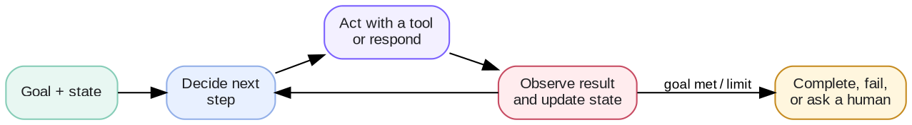

# Week 5 · Agent Engineering — Concepts

## At a glance

| Learn | Build | Key terms | Watch for |
| --- | --- | --- | --- |
| Design a multi-step system that observes, decides, acts, and tracks progress | Mini Muse's agent loop, with a step cap and approval before email | Goal, task, agent loop, step, turn · workflow, checkpoint, approval | Agents need stop conditions, budgets, and human approval paths |

## 1. What makes a system an agent?

An agent is an application that pursues a goal across multiple steps. It keeps state, chooses a next action, uses tools when needed, observes the result, and stops according to explicit rules.



Not every multi-step feature needs a model-driven agent. A fixed workflow is usually simpler when the paths and decisions are already known.

## 2. Eight words that get mixed up

People use these words loosely, and that causes real design bugs: a step cap that is too small, an approval that never comes back, a "checkpoint" that is only a hope in the prompt. They fall into two groups.

**What the agent is doing**

| Term | What it is | How you know you have one | In Mini Muse |
| --- | --- | --- | --- |
| **Goal** | The outcome the user wants. It is done when it is *true*, not when work stops. | You can write a check for it: "Maya has the agenda", "prep is on the calendar". | The user's request, for example "Email Maya the agenda and book prep on Tuesday at 10". |
| **Task** | One unit of work toward the goal. One goal usually breaks into several tasks. | It has its own result you can inspect. | Look up Maya · draft the email · send it · check Tuesday · book the prep. |
| **Agent loop** | The engine that repeats *decide → act → observe* until it stops. | There is a loop in code with a stop condition and a cap. | `for step in range(1, max_steps + 1)` in `week5_agent.run()`. |
| **Step** | One pass through the loop: one model call, plus any tool calls it asked for. | It is what `max_steps` counts. | Step 2: the model asks for `check_calendar(2026-10-27)` and gets the result. |
| **Turn** | One user message (or action) and the reply to it. One turn can contain many steps. | The user typed or clicked something. | "Email Maya…" is turn 1. Clicking **Approve** is turn 2. |

**How the system controls it**

| Term | What it is | How you know you have one | In Mini Muse |
| --- | --- | --- | --- |
| **Workflow** | The designed path: the stages, the allowed moves between them, and the end states. Written by you, in code. | You could draw it as a flowchart before any model runs. | Understand → agent loop → hold risky actions → approve → done. |
| **Checkpoint** | A fixed point where the system *verifies* something or *saves progress* before going on. It is automatic: no human needed. | It runs every time, whatever the model decides. | Check the calendar before booking. Record held actions in `pending_actions`. |
| **Approval** | A checkpoint where a **human** must say yes before a risky or irreversible action runs. | The action is held, shown to the user, and only runs on their click. | `send_email` is never run inside the loop. It waits for **Approve**, then `approve()` runs it. |

### The difference that matters

- **Goal vs task.** The goal is the *why*; tasks are the *how*. The agent can finish every task and still miss the goal (the email went to the wrong Maya). Check the goal, not just that tasks ran.
- **Agent loop vs workflow.** The loop lets the *model* choose the next step. The workflow is the fence *you* draw around it: which stages exist, what must happen before what, where it must stop. A pure workflow has no loop; a pure loop has no fence. Good agents have both.
- **Step vs turn.** Steps are the agent's internal moves; turns are the conversation. `max_steps` limits steps inside one turn. Approval always ends the turn and needs a new one.
- **Checkpoint vs approval.** Every approval is a checkpoint, but most checkpoints should not bother a human. Use approval only when an action is risky, costly, or hard to undo. Otherwise check automatically.

## 3. One request, traced end to end

**Request:** *"Email Maya the Monday agenda and book a 30-minute prep on Tuesday at 10."*
**Goal:** Maya has the agenda **and** a prep event is on Tuesday at 10:00, with no double-booking.

| Turn | Step | The model decides | The system does | Control in play |
| --- | --- | --- | --- | --- |
| 1 | 1 | Call `lookup_contact("Maya")` and `check_calendar("2026-10-27")` | Runs both tools, returns Maya's email and Tuesday's events | Tool arguments validated |
| 1 | 2 | Call `create_event(...)` for 10:00 | Tuesday is free, so it books the prep | **Checkpoint:** calendar checked before booking |
| 1 | 3 | Call `send_email(to=maya@…)` | Does **not** send. Holds it in `pending_actions`, replies "needs approval" | **Approval:** risky action held |
| 1 | 4 | Answer: "Booked prep. Here's the draft to Maya. Should I send it?" | No tool call, so the loop stops: `status="done"` | Stop condition: model answered |
| 2 | — | User clicks **Approve** | `approve()` sends the held email | Human said yes |

Things to notice:

- **4 steps, 2 turns.** With `max_steps=3`, this request would stop before the draft. Size the cap for your longest real request, plus a little room.
- **The goal is only met after turn 2.** If the user never approves, the loop still ended correctly, but the goal is not complete. Your UI must show what is still waiting.
- **Two tools in one step.** A model can ask for several tools in one step. The step count is not the tool count.

## 4. Design the workflow first

A workflow defines stages, valid transitions, and terminal states. Make deterministic decisions in code; use an LLM only where judgment is needed.

```text
Request → Understand → Agent loop (decide → act → observe) → Check result → Done
                              ↘ Risky action → Hold → Ask for approval → Run on "yes"
                              ↘ Step cap / error → Stop safely and say why
```

Write the transition rules down before you prompt anything:

| Rule | Type | Where it lives in Mini Muse |
| --- | --- | --- |
| Never send email without the user's OK | Approval | Code: `send_email` is in `RISKY_TOOLS`, so the loop holds it |
| Check the calendar before booking | Checkpoint | Prompt: a rule in `RULES` |
| Stop after `max_steps` | Budget | Code: the loop's range |
| Stop when the model answers without a tool call | Stop condition | Code: `if not reply.tool_calls` |
| Retry a failed tool once or twice | Recovery | Code: Week 7's `Runtime` |

**A practical warning:** Mini Muse's calendar check is a rule *in the prompt*, so the model can still skip it. The email approval is enforced *in code*, so it cannot. When a check really matters, move it from the prompt into code: for example, refuse `create_event` unless `check_calendar` ran for that date earlier in the same turn.

## 5. State, context, and memory

| Concept | Meaning | Mini Muse example |
| --- | --- | --- |
| State | Structured facts about the current run | `steps`, `tool_calls`, `pending_actions`, `status` |
| Context | What is sent to the model on this call | System instructions, the request, earlier tool results |
| Memory | What is kept beyond this run | Week 2's saved facts and summary |

State is the source of truth for progress. Keep it explicit and machine-readable. Do not rely on reading the conversation to decide whether an email was already sent: check `final_state["emails_sent"]`.

```python
trace = {
    "status": "done",                 # done | max_steps
    "steps": [...],                   # one entry per pass through the loop
    "tool_calls": [...],              # what actually ran
    "pending_actions": [              # held for approval, not run yet
        {"tool": "send_email", "args": {"to": "maya@example.com", "subject": "Monday agenda"}}
    ],
}
```

## 6. Routing

Routing answers: **what should happen next?** It can pick a workflow stage, a tool, a retrieval step, or a specialist.

| Route type | Best use | Example |
| --- | --- | --- |
| Deterministic rule | Known conditions | Tool is risky → hold for approval |
| LLM router | Ambiguous intent | "Can you sort out Tuesday?" → calendar or email? |
| Hybrid | Rules for clear cases, model for the rest | Code holds risky tools for approval; the model picks every other tool |

Prefer rules for safety boundaries. A model router should only choose from an allowed, well-described set of options.

## 7. Tools, validation, and approval

Every action has an owner outside the model:

1. The model **proposes** an action.
2. The runtime **validates** the tool name and arguments.
3. Policy **checks** budgets and whether approval is needed.
4. The tool **runs** and returns an observable result.
5. State **records** what actually happened.

Tool results are evidence, not instructions. Treat retrieved text and external responses as untrusted input.

## 8. Single agent before multi-agent

Use one agent with a clear workflow unless separate roles truly need different context, tools, permissions, or evaluation criteria.

| Add a specialist when | Keep one agent when |
| --- | --- |
| It needs isolated credentials, narrow context, or its own quality gate | It is only a different step in the same workflow |
| A handoff can be written as a clear contract | Passing context would add more complexity than value |

Each handoff should list inputs, allowed tools, expected outputs, and exit criteria.

## 9. Evaluate the workflow

Measure whether the **goal** was met, not just whether the loop ended. Also check behavior: the right tools in the right order, checkpoints honored, risky actions held for approval, and a sensible stop. Record a trace for every run so a failure can be diagnosed without guessing what the model saw or did. Week 6 turns these checks into a golden dataset.

## Check yourself

1. A request takes 5 steps and `max_steps` is 4. What does the user see, and is the goal met?
2. Why does approval always create a new turn, but not a new goal?
3. Name one checkpoint in your own project that should be automatic, and one that needs approval.
4. Mini Muse's calendar check lives in the prompt. How would you enforce it in code?

**Core mental model:** the model proposes the next step; the workflow, checkpoints, and approvals decide what may actually happen.

## References

- [OpenAI API — Agents](https://developers.openai.com/api/docs/guides/agents)
- [OpenAI API — Function calling](https://developers.openai.com/api/docs/guides/function-calling)
- [OpenAI API — Safety in building agents](https://developers.openai.com/api/docs/guides/agent-builder-safety)
- [OWASP — AI Agent Security Cheat Sheet](https://cheatsheetseries.owasp.org/cheatsheets/AI_Agent_Security_Cheat_Sheet.html)
- [Hugging Face Agents Course](https://huggingface.co/learn/agents-course/en/unit1/introduction)
