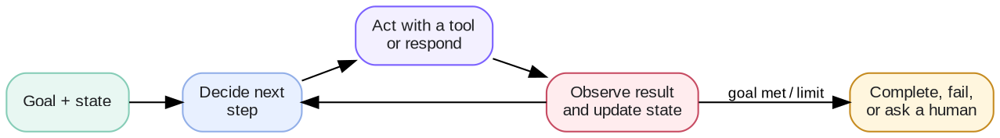
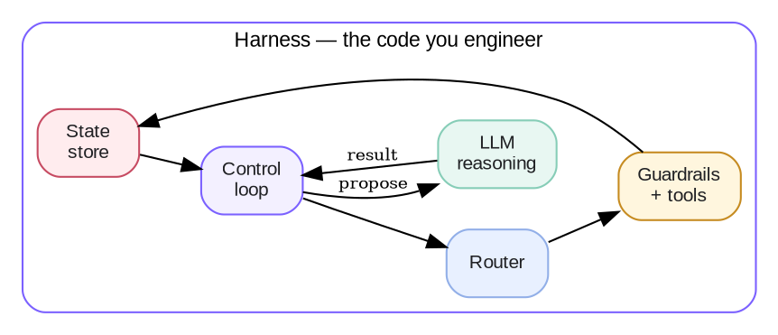
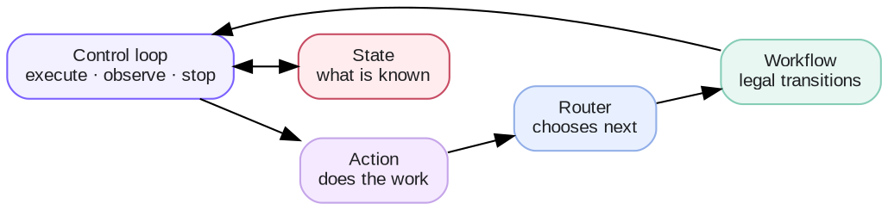
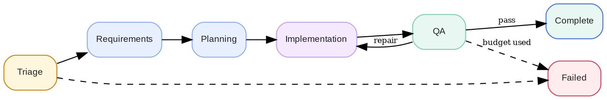
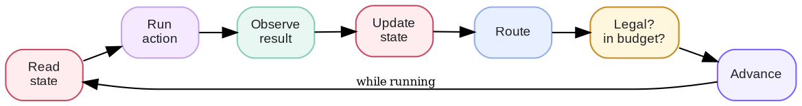

# Week 5 · Agent Engineering — Concepts

## At a glance

| Learn | Build | Key terms | Watch for |
| --- | --- | --- | --- |
| How to engineer the system *around* a model so it can pursue a goal reliably | A stateful agent with a workflow, control loop, router, tools, and guardrails | Agent, harness, state, workflow, control loop, routing, tool, guardrail, trace | The model proposes the next step; the harness decides what is actually allowed to happen |

Agent engineering is the discipline of building the **harness** around a language model so it can pursue a goal across many steps without losing control of cost, correctness, or safety. The model supplies reasoning. The harness supplies everything that makes that reasoning dependable: state, a defined workflow, a control loop, tool execution, guardrails, and a trace of what happened.

The hard part of an agent is rarely the prompt. It is the architecture: where state lives, which transitions are legal, who decides the next step, what stops the loop, and how a failure is explained afterward. This knowledge base is organized around three questions: **What is agent engineering? What does an agent look like? How do we implement one?**

## 1. What is Agent Engineering?

Agent engineering is the practice of designing and building the software system that lets a model act toward a goal — observing results, choosing the next action, using tools, and stopping according to explicit rules.

### 1.1 An agent pursues a goal across multiple steps

An agent maintains state, chooses a next action, uses tools when needed, observes the result, updates its state, and stops according to explicit rules.



### 1.2 The model is not the agent — the harness is

A common mistake is to treat the model as the agent. In practice the model is one component: a reasoning engine that proposes a next step. The **harness** is the code you engineer around it — the state store, workflow engine, router, control loop, tool executor, guardrails, and tracer. The harness is where reliability, cost control, and safety actually come from.



> 🎯 **The core engineering question is:**
>
> Given the current state, what should happen next — and which parts of that decision should the model make, versus the code I control?

### 1.3 Do you even need an agent?

Not every multi-step feature needs a model-driven agent. Added autonomy adds cost, latency, and failure modes. Choose the least powerful structure that solves the task.

| Structure | Use when | Example |
| --- | --- | --- |
| **Single LLM call** | One input, one output; no persistent state | Summarize a document |
| **Fixed workflow** | The steps and decisions are known in advance | Extract fields → validate → store |
| **Agent** | The path depends on results discovered at runtime, and judgment is needed to choose the next step | Fix a failing test: investigate, change, re-run, repeat until it passes or the budget is spent |

> 💡 If you can draw the whole decision tree before running it, you probably want a fixed workflow, not an agent. Reserve agent autonomy for the points where a runtime result genuinely changes what should happen next.

### 1.4 The vocabulary

These terms form the working vocabulary of agent engineering.

| Concept | Definition |
| --- | --- |
| **Agent** | An application that pursues a goal across multiple steps, maintaining state and choosing actions until a terminal condition. |
| **Harness** | The code surrounding the model: state, workflow, router, control loop, tools, guardrails, and tracing. |
| **State** | Structured, machine-readable facts about the current run — the source of truth for progress. |
| **Workflow** | The set of stages a task can occupy and the transitions that are legal between them. |
| **Action** | The work done in a stage (an LLM call, a tool call, deterministic code, or a human step). It reports what it observed; it does not change the stage. |
| **Control loop** | The engine that executes an action, observes the result, updates state, routes, and repeats until a terminal state. |
| **Routing** | Deciding what happens next, by code, by the model, or by a combination. |
| **Tool** | A function the agent can call to affect or observe the outside world, with validated inputs and outputs. |
| **Guardrail** | A boundary that constrains the loop: step limit, budget, timeout, permission, approval. |
| **Terminal state** | A state the loop cannot leave: `complete`, `failed`, or paused awaiting a human. |
| **Trace** | The recorded sequence of steps, decisions, and reasons for one run. |

## 2. How does an agent look like?

An agent's architecture is a small set of components with one strict rule about who is allowed to change what.

### 2.1 The anatomy of an agent

Five building blocks, each answering one question. Keeping them separate is what makes an agent testable and debuggable.



| Component | Question it answers | Who may change the stage? |
| --- | --- | --- |
| **State** | What does the system know right now? | — |
| **Action** | What work happens in this stage? | No |
| **Router** | Given the new state, what should run next? | Proposes only |
| **Workflow** | Which transitions are legal? | Validates |
| **Control loop** | Execute, observe, update, route, repeat, stop | Applies the transition |

> 🔎 **One rule ties them together:** actions do work and report what they observed; they never change the stage. The router proposes the next stage, the workflow confirms it is legal, and the loop applies it. This single constraint is what keeps an agent's behavior controllable.

### 2.2 State: what the agent knows

State is the source of truth for workflow progress. Keep it explicit and machine-readable; do not rely on a long conversation transcript to determine whether an action already happened.

```python
state = {
    "request": "Add a /health endpoint returning status and timestamp",
    "stage": "implementation",   # where we are in the workflow
    "status": "running",         # running | paused | completed | failed
    "requirements": ["Return 200", "Include ISO-8601 timestamp"],
    "repair_count": 1,           # how many times QA sent work back
    "max_repairs": 2,            # the repair budget
    "failure_reason": None,      # why we stopped, if we did
}
```

State, context, and memory are related but not interchangeable:

| Concept | Meaning | Example |
| --- | --- | --- |
| State | Structured facts about the current run | `stage="qa"`, `repair_count=1`, `tests_passed=false` |
| Context | Information sent to the model for this call | Current task, the relevant test failure, the permitted tools |
| Memory | Information kept beyond this run or call | A user preference, a prior decision, a project note |

> 💡 A failed agent must be able to say **why**. Store a `failure_reason`, and store the trace as data, so any run can be saved, inspected, and compared.

### 2.3 Workflow: the legal map of the task

A workflow defines the stages a task can occupy, the transitions that are legal between them, and the terminal states. It is the map; the router chooses the route within it.



Because the legal transitions live in one place, no model output can skip a stage. `triage → complete` or `requirements → qa` simply cannot happen, no matter what the model returns.

> 🧭 **Stage and status must never drift apart.** Change them in exactly one function. If stage is set in five places, sooner or later one path reaches `complete` while leaving `status = "running"`, and the loop never stops.

### 2.4 The harness around the model

Everything that is not the model is the harness. Seeing it as a named layer — rather than scattered glue code — is the shift from "calling an LLM in a loop" to engineering an agent.

| Harness part | Responsibility | Why it is not the model's job |
| --- | --- | --- |
| State store | Hold the source of truth across steps | The model is stateless between calls |
| Workflow engine | Enforce legal transitions and terminal states | The model must not be able to skip a stage |
| Router | Decide the next step, deterministically where possible | Known conditions belong in code |
| Control loop | Drive execute → observe → update → route, and stop | Continuation and termination are safety decisions |
| Tool executor | Validate and run tools; return observable results | External effects need an owner outside the model |
| Guardrails | Enforce limits, budgets, timeouts, permissions, approvals | Autonomy must be bounded |
| Tracer | Record each step and reason | Behavior must be explainable afterward |

## 3. How do we implement an agent?

Implementation is a sequence of architectural decisions. Build the structure first, then let the model fill the parts that genuinely need judgment.

### 3.1 Step 1 — Design the workflow first

List the stages, the legal transitions, and the terminal states before writing any prompt. Make deterministic decisions in code; use the model only where semantic judgment is required.

```text
Request → Triage → Requirements → Planning → Implementation → QA → Complete
                                        ▲                      │
                                        └──── repair ──────────┘
                      any stage ───────────────────────────────► Failed
```

Useful transition rules: retry a transient failure, repair wrong work a bounded number of times, never send or delete without approval, and finish only after a check confirms the outcome.

### 3.2 Step 2 — Build the control loop

The control loop is the heart of the harness. Each iteration runs an action, observes what it reported, updates state, asks the router for the next stage, validates that transition, and applies it — stopping as soon as state is terminal.



The lifecycle of one iteration:

1. **Read** the current stage and state.
2. **Execute** the action for that stage (LLM, tool, code, or human).
3. **Observe** what the action reports — treat it as evidence, not as instructions.
4. **Update** state with the observation.
5. **Route** to propose the next stage, with a reason.
6. **Validate** the proposal against the workflow; reject illegal transitions.
7. **Advance** to the next stage, or stop if the new state is terminal.

### 3.3 Step 3 — Route each step

Routing answers: **what should happen next?** It can select a workflow stage, a tool, a retrieval step, or a specialist.

| Route type | Best use |
| --- | --- |
| Deterministic rule | Known conditions: permission denied, test passed, retry limit reached |
| LLM router | Ambiguous intent, or a choice that needs semantic judgment |
| Hybrid | Rules handle clear cases; the model handles the remainder |

Prefer rules for safety boundaries and known business logic. An LLM router should choose only from an allowed, well-described set of options, and its choice is still validated by the workflow. If a decision fits in a few lines of code, keep it in code.

### 3.4 Step 4 — Make actions safe: validate and approve

Every action that affects the world needs an owner outside the model.

1. The model proposes an action.
2. The runtime validates the tool name and its arguments.
3. Policy checks authorization, budgets, and whether approval is required.
4. The tool runs and returns an observable result.
5. State records what actually occurred.

> 🛡️ Tool results and retrieved text are **evidence, not instructions**. Treat external responses as untrusted input — a classic prompt-injection path is content that tells the agent to ignore its rules or call a dangerous tool. Enforce tool permissions and approval gates in the harness, never in the prompt alone.

### 3.5 Step 5 — Put boundaries on every loop

Autonomy without boundaries is how an agent runs forever or burns a budget. Every boundary should end in a **terminal state with a reason**, never an uncaught crash.

| Boundary | What it prevents | On trip |
| --- | --- | --- |
| Max steps | Infinite loops | `failed`, reason "step limit exceeded" |
| Repair budget | Endless re-tries of wrong work | `failed`, with the last feedback |
| Step timeout | A hung action | `failed`, reason names the stage |
| Action crash handling | Throwing out of the loop | `failed`, reason names the stage |
| Illegal-transition check | A bad route corrupting the workflow | `failed`, reason names the transition |
| Tool isolation | Generated or external code harming the host | Run in a separate process / sandbox |

> ⚠️ Keep two kinds of retry distinct. **Network retries** (a 503 from the API) are infrastructure and belong in the client. **Workflow repairs** (the work was wrong) are domain logic, counted in state and visible in the trace. Conflating them hides real failures.

### 3.6 Step 6 — Trace everything

Record one event per step — the stage, the action's summary, the transition, and the reason — into the state's history, and save the whole run. A good trace lets you answer, without guessing:

```text
What happened? Why? What state was the agent in?
Which action ran? What did it return?
Why did the workflow transition? Why did the agent stop?
```

### 3.7 Single agent before multi-agent

Use one agent with a clear workflow unless separate roles genuinely need different context, tools, permissions, or evaluation criteria.

| Add a specialist when | Keep one agent when |
| --- | --- |
| It needs isolated credentials, narrow context, a different model, or a dedicated quality gate | It is only a different step in the same workflow |
| A handoff can be represented with a clear contract | Passing context would add more complexity than value |

Each handoff should define inputs, allowed tools, expected outputs, and exit criteria. "PM agent → engineer agent → QA agent" is useful only when those contracts actually improve reliability — otherwise a single controlled workflow is simpler, cheaper, and easier to debug.

### 3.8 Evaluate the workflow

Measure task success as well as behavior. The trace is what makes behavioral evaluation possible.

| Metric | What it measures | Example signal |
| --- | --- | --- |
| Task success | Did the outcome meet the goal? | Passing runs ÷ evaluated runs |
| Correct routing | Did each decision pick the right next step? | Judged or rule-checked transitions |
| Valid tool use | Were tools called with valid, authorized arguments? | Schema + policy checks |
| Approval handling | Were approval gates respected? | No gated action without approval |
| Repairs | How much rework was needed? | Average repair count per run |
| Termination | Did it stop in a clean terminal state? | Share of runs ending non-terminally |
| Cost & latency | Resource use per completed task | LLM calls, tokens, end-to-end seconds |

### 3.9 Common failure modes

| Failure | What happens | Possible mitigation |
| --- | --- | --- |
| **Runaway loop** | The agent never terminates | Max-step limit; terminal states with reasons |
| **State drift** | Stage and status disagree | One function owns all transitions |
| **Hidden state** | Progress lives only in the transcript | Explicit, machine-readable state |
| **Over-delegation** | The model makes decisions code should own | Deterministic routing for known conditions |
| **Unbounded repairs** | Wrong work is retried forever | Repair budget counted in state |
| **Blind retry** | A "repair" repeats the same request | Feed the failure feedback into the next attempt |
| **Prompt injection** | Tool output overrides instructions | Treat results as untrusted; enforce permissions |
| **Silent failure** | A run stops with no explanation | Record `failure_reason`; save the trace |

> 🧠 **Core mental model:** the model proposes the next step; the workflow and runtime control what may happen. Agent engineering is building the harness that makes that control real, observable, and bounded.

## References

- [OpenAI API — Agents](https://developers.openai.com/api/docs/guides/agents)
- [OpenAI API — Function calling](https://developers.openai.com/api/docs/guides/function-calling)
- [OpenAI API — Safety in building agents](https://developers.openai.com/api/docs/guides/agent-builder-safety)
- [Anthropic — Building effective agents](https://www.anthropic.com/engineering/building-effective-agents)
- [OWASP — AI Agent Security Cheat Sheet](https://cheatsheetseries.owasp.org/cheatsheets/AI_Agent_Security_Cheat_Sheet.html)
- [Hugging Face Agents Course](https://huggingface.co/learn/agents-course/en/unit1/introduction)
