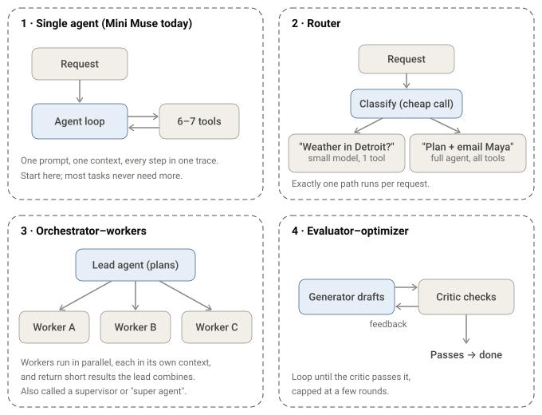
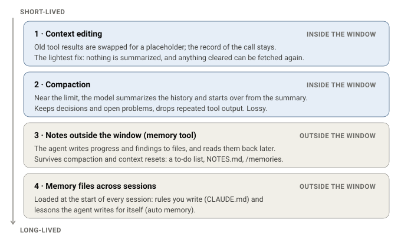

# Week 5 · Agent Engineering — Concepts

## At a glance

| Learn | Build | Key terms | Watch for |
| --- | --- | --- | --- |
| What an agent is made of, how to build one that stays in control, when one agent isn't enough, and how agents remember | An agent: a loop, a harness, and a workflow | Agent loop, harness, workflow, router, orchestrator–workers, handoff, compaction, memory tool | The model proposes the next step; your code decides what is allowed to happen |

An **agent** pursues a goal across many steps instead of answering in one call. This page answers four questions: **what an agent looks like**, **how you implement one**, **when to use more than one agent**, and **how an agent remembers**. For short definitions of any term, see the **Glossary**.

## 1. What an agent looks like

An agent is a **harness wrapped around an LLM**, driven by a short **loop**. The model supplies judgment on each turn; the harness holds state, runs actions, and keeps the whole thing bounded.

### 1.1 The agent loop

An agent runs a short cycle over and over: ask the model what to do next, run that action, add the result back into the context, and repeat until the goal is met or a limit is hit.

The key point is that **the model decides the next step on every turn**. That is what makes it an agent rather than a fixed script: the path is not written in advance, it emerges from each result. The loop keeps going while there is more to do and stops when the goal is reached, a step/budget limit is hit, or it needs a human.

### 1.2 The harness

The model only ever receives a prompt and returns a proposed next action — it is stateless between calls and cannot touch the outside world. Everything that makes the loop dependable lives in the **harness**, the code you control.

| Harness part | What it does |
| --- | --- |
| **Agent loop** | Repeats ask → act → observe until done |
| **Context** | Builds the prompt sent to the model each turn |
| **Memory** | Persists state and facts across steps |
| **Tools** | Run real actions and reach the environment (files, shell, APIs) |
| **Guardrails** | Enforce limits, permissions, and approvals |

> 🎯 Reliability, cost control, and safety come from the **harness**, not the model. The model supplies judgment; the harness decides what that judgment is actually allowed to do.

## 2. How do we implement an agent

Building an agent is mostly deciding where the model gets freedom and where your code stays in charge. Design the **workflow** first, then let the loop run only inside the stages that genuinely need judgment.

### 2.1 Design the workflow

A loop on its own can wander. A **workflow** gives it a map: the fixed stages a task moves through and the legal transitions between them. The agent loop runs inside the open-ended stage; the stages around it are deterministic steps you control.

This hybrid is what keeps an agent bounded. The surrounding stages — intake, planning, checking the result against the goal — are plain code with known transitions. Only **Run next task** hands control to the model-driven loop, and only until that task is done. Every run ends at a defined terminal state (`done`, or `failed` with a reason), so the agent has freedom exactly where judgment is needed and nowhere else.

> 💡 If you can draw the whole decision tree before running it, you want a fixed workflow, not an agent. Reserve the agent loop for the stages where a runtime result genuinely changes what should happen next.

### 2.2 Build it in order

With the workflow drawn, the rest is filling it in — structure first, model last.

1. **Define the workflow** — stages, legal transitions, and terminal states — before writing any prompt.
2. **Build the control loop** that runs each stage, updates state, and stops as soon as state is terminal.
3. **Let the model drive only the open-ended stage**; keep known decisions in code.
4. **Give every tool an owner:** validate its arguments, check permissions, and require approval for risky actions.
5. **Bound every loop** — max steps, budget, timeout — each ending in a terminal state with a reason, never a crash.
6. **Trace every step** so any run can be explained, saved, and evaluated.

> 🛡️ Tool results and retrieved text are **evidence, not instructions**. Treat external responses as untrusted input, and enforce tool permissions and approval gates in the harness, never in the prompt alone.

### 2.3 Keep a human in the loop

Some actions are too costly to undo for the agent to take on its own — sending a message, spending money, deleting data, changing production. For these, the loop should **pause and ask a person to approve** before the tool runs, then resume with the decision recorded in state.

An approval gate is just another guardrail, but instead of ending the run it moves it into a **paused** state: the agent waits for a human decision rather than stopping. The model may *propose* a risky action; only an approval lets the tool actually run.

| The agent may act on its own | Require human approval first |
| --- | --- |
| Read-only or easily reversible actions — search, read a file, draft text | Irreversible or high-impact actions — send, pay, delete, publish, change production |

> 🧭 Keep the gate in the harness, not the prompt, and record **who approved what**. A model can be talked out of a rule; an approval check in code cannot, and the trace then explains every side effect.

## 3. When one agent isn't enough

Mini Muse is a **single agent**: one loop, one system prompt, one context window, and 6–7 tools. That is the right design for it, and for most first agents. This section covers what comes next: the patterns teams reach for when a single loop stops being enough, what each one costs, and how to tell whether you need one.

### 3.1 Four patterns, simplest first

**Router.** One cheap classification call picks which prompt, model, or tool set handles the request. Exactly one path runs.
- *In Mini Muse:* "What's the weather in Detroit?" goes to a small model with only `get_weather`. "Plan Friday and email Maya" goes to the full agent.
- *In a real product:* customer support triage, where refund questions, technical issues, and general questions each get their own prompt and tools. Anthropic's agent guide gives another: easy questions to a small, cheap model and hard ones to a stronger model.

**Orchestrator–workers** (also called a supervisor or "super agent"). A lead agent decides the subtasks *at runtime*, sends each to a worker agent with its own context, then combines the short results.
- *In Mini Muse:* "Plan the team offsite." One worker finds a free day on the calendar, one pulls the budget from your notes, and one drafts the invite. The lead combines them and holds the email for approval.
- *In a real product:* Claude's Research feature, where a lead agent runs 3–5 search agents in parallel (see 3.3).

**Evaluator–optimizer.** One call drafts, a second call critiques against explicit criteria, and the draft is revised until it passes or hits a round cap.
- *In Mini Muse:* before the email to Maya is held for approval, a critic checks it against your notes ("Is the agenda item correct? Is the tone right?") and asks for at most two revisions.
- *In a real product:* code agents that write a change, run the tests, and fix what fails; writing tools that check a draft against a style guide.

**Handoffs.** A specialist agent takes over the conversation and owns the next reply, instead of reporting back to a manager.
- *In Mini Muse:* not needed today. If Mini Muse grew a separate travel-booking agent, the main agent would hand the conversation to it.
- *In a real product:* support flows that go triage agent → billing agent → escalation agent.

These patterns combine: the orchestrator's workers can be routers, and a worker can run its own evaluator–optimizer loop. Start with one.

### 3.2 Manager or handoff: who owns the reply?

When agents work together, one design choice shapes everything else: does the first agent **stay in charge**, or does it **give the conversation away**? The OpenAI Agents SDK names these two options explicitly.

**Agents as tools (a manager).** The manager calls a specialist like a function, gets its result back, and decides what to do next. The manager always writes the reply to the user. It can call several specialists at once, and every decision sits in one trace, so it is easy to debug. Use it for fan-out and fan-in work: research, or a plan built from several sources.

**Handoffs.** The specialist takes over and talks to the user directly. Only one agent works at a time, and to see why a conversation ended up somewhere, you follow the chain of handoffs. Use it when the domains are clearly separate and each needs its own instructions and permissions, such as billing vs. tech support.

In Mini Muse terms, the approval gate is easier to keep with a manager: one agent owns every risky action, so one place holds them all for approval.

### 3.3 Case study: Claude's Research feature, with real numbers

Anthropic published how they built Claude's Research feature, a multi-agent system in production. It is a useful benchmark for what multi-agent buys you and what it costs.

- **Architecture.** A lead agent plans the research, saves the plan to memory, and spawns subagents. Each subagent searches in parallel in its own context window and returns condensed findings. A separate citation agent adds the citations at the end.
- **How many agents.** The lead usually starts 3–5 subagents in parallel. The prompt scales effort to the question: simple fact-finding gets 1 agent and 3–10 tool calls; a direct comparison gets 2–4 subagents with 10–15 calls each; complex research gets 10 or more subagents with clearly divided jobs.
- **The gain.** A Claude Opus 4 lead with Claude Sonnet 4 subagents scored **90.2% higher** than a single Claude Opus 4 agent on Anthropic's internal research eval.
- **The cost.** A single agent uses about **4×** the tokens of a chat. The multi-agent system uses about **15×**. On the BrowseComp benchmark, token usage alone explained **80%** of the difference in performance: the system wins largely because it can spend more tokens across more context windows.
- **What went wrong first.** Early versions started 50 subagents for simple questions, kept searching for sources that don't exist, and gave vague instructions that sent two subagents after the same question.
- **Where it doesn't fit.** Tasks where every agent needs the same context, tasks where subtasks depend on each other, and most coding tasks, which split into fewer independent pieces than research does.

> 🎯 Multi-agent wins when the work splits into **independent threads that can run in parallel** and the answer is worth roughly 15× the tokens. Research fits. Booking yoga after checking the calendar does not: the second step depends on the first.

### 3.4 Should your agent be multi-agent? Five questions

Answer these about your own agent. Split only where the answer is clearly yes. The Mini Muse answers are filled in as an example.

1. **Do subtasks run independently, without needing each other's results?** If yes, orchestrator–workers can run them in parallel.
   - *Mini Muse:* mostly no. Booking depends on checking the calendar first.
2. **Do parts need different tools or permissions?** If yes, separate agents can keep a read-only agent away from sending email.
   - *Mini Muse:* partly. Reading notes is safe and sending email is risky, but the approval gate already handles that.
3. **Would a cheaper model handle most requests?** If yes, add a router.
   - *Mini Muse:* yes. Weather and single calendar checks don't need the full agent. This is the first split worth trying.
4. **Does the context overflow one window?** If yes, workers with their own context can return summaries.
   - *Mini Muse:* no. Requests are short.
5. **Is the result worth about 15× the tokens?** If yes, multi-agent can pay off.
   - *Mini Muse:* no. Requests are quick and personal.

For Mini Muse, the verdict is: stay a single agent, and try a **router** first if cost matters.

> 💡 Every extra agent adds a prompt to maintain, a context to keep in sync, and a place for errors to compound. Add one only when you can name what it gets that the single loop can't: different tools, a different model, its own context window, or parallel speed.

## 4. How agents remember: Anthropic's memory components

An agent's context window is its **working memory**, and it is finite. Every tool result stays in it, so a long task fills it up: the model slows, costs climb, and older details get less attention. Anthropic treats context as a budget to spend carefully, and splits agent memory into four components, by **how long the memory has to last**.

### 4.1 Context editing: clear what you can fetch again

The lightest fix works *inside* the window. When the conversation grows past a threshold you set, the API replaces the **oldest tool results** with a short placeholder saying the result was removed. By default the record of each tool call stays, so the model still knows what it did and can call the tool again if it needs the data back. In Anthropic's API this is the `clear_tool_uses` strategy.

- *Why it works:* tool results are usually the biggest and least reusable part of the context: file contents, search results, API responses.
- *In Mini Muse:* after 10 steps, a calendar result from Step 2 is cleared, but the agent can still see that it checked the calendar and can check again.

### 4.2 Compaction: summarize and start fresh

When the window is nearly full, the model summarizes the conversation so far, and the agent continues from that summary instead of the full history. Claude Code keeps architectural decisions, unresolved bugs, and implementation details, drops repeated tool output, and continues with the summary plus the **five most recently accessed files**.

- *How to tune it:* Anthropic's advice is to first make the summary capture everything that might matter (recall), then cut what turns out to be unneeded (precision).
- *The catch:* compaction is lossy. Anthropic found it was not enough on its own for work spanning several context windows, because a summary doesn't always tell the next window clearly what to do. That gap is what notes fill.

### 4.3 Notes outside the window: the memory tool

Here the agent writes notes to storage **outside** the context window, and reads them back when it needs them. Notes survive compaction and context resets, because they never lived in the window.

- *Examples from Anthropic:* Claude Code keeps a to-do list, and custom agents keep a `NOTES.md` file. In Anthropic's Pokémon experiment, Claude kept precise notes across thousands of game steps (objectives, explored areas, battle strategies), and after each context reset it read its notes and picked up where it left off.
- *The memory tool* is Anthropic's API version of this. Claude gets a `/memories` directory and six file commands: `view`, `create`, `str_replace`, `insert`, `delete`, and `rename`. When it's enabled, Claude checks its memory directory before starting a task.
- *It runs on your side:* Claude only *asks* for memory operations. Your application carries them out against storage you control, such as files, a database, or encrypted storage. That also makes security your job: Anthropic's docs say your handler must reject any path outside `/memories`, so the model can't read or write other files.

The measured effect: on Anthropic's evaluation of long agentic search tasks, context editing alone improved performance by **29%**, and the memory tool combined with context editing by **39%**.

### 4.4 Memory files across sessions: Claude Code's two kinds

Every new session starts with an empty context window. Claude Code carries knowledge over with two kinds of files, both loaded at the start of every session:

- **CLAUDE.md, which you write:** instructions and rules, like "use conventional commits" or "run the tests before pushing." It can sit at several levels: organization-wide, your user account, the project (committed to git for the whole team), and a local file just for you.
- **Auto memory, which Claude writes:** notes Claude keeps based on your corrections and preferences, stored per project as a `MEMORY.md` index plus topic files. Only the start of `MEMORY.md` loads each session, so the index stays short and points to the topic files.

The split matters: rules you write are authoritative, while lessons the agent writes for itself are its own notes, which you can read and correct.

### 4.5 Subagents as memory isolation

The subagents from §3 are also a memory technique. A subagent can read tens of thousands of tokens in its own context window and return a summary of about **1,000–2,000 tokens**. The main agent keeps the conclusion without the raw material.

### 4.6 What this means for Mini Muse

Mini Muse's working memory is its `messages` list: every step adds the model's reply and the tool results. Its runs are short, so it doesn't need any of this yet. Here's where each piece would come in:

- **Long multi-step runs:** clear old tool results first (4.1). It's the cheapest fix and loses nothing that can't be fetched again.
- **Remembering you across sessions:** a small memory file of stable facts, like "vegetarian" or "prefers morning meetings," loaded at the start of each run (4.4). Week 2's saved facts are the start of this.
- **Long tasks that span many windows:** a progress file the agent updates as it goes (4.3), not just a summary.

> ⚠️ Treat memory as untrusted input. If a web page or email tricks the agent into saving an instruction, that instruction comes back in every future session. Save only what the user said or confirmed, and keep memory readable so you can check it.

## References

- [OpenAI API — Agents](https://developers.openai.com/api/docs/guides/agents)
- [Anthropic — Building effective agents](https://www.anthropic.com/engineering/building-effective-agents)
- [Anthropic — How we built our multi-agent research system](https://www.anthropic.com/engineering/multi-agent-research-system)
- [OpenAI API — Orchestration and handoffs](https://developers.openai.com/api/docs/guides/agents/orchestration)
- [Anthropic — Effective context engineering for AI agents](https://www.anthropic.com/engineering/effective-context-engineering-for-ai-agents)
- [Anthropic — Managing context on the Claude Developer Platform](https://www.anthropic.com/news/context-management)
- [Claude API docs — Memory tool](https://platform.claude.com/docs/en/agents-and-tools/tool-use/memory-tool)
- [Claude API docs — Context editing](https://platform.claude.com/docs/en/build-with-claude/context-editing)
- [Claude Code docs — Memory](https://code.claude.com/docs/en/memory)
- [OWASP — AI Agent Security Cheat Sheet](https://cheatsheetseries.owasp.org/cheatsheets/AI_Agent_Security_Cheat_Sheet.html)
- [Hugging Face Agents Course](https://huggingface.co/learn/agents-course/en/unit1/introduction)
