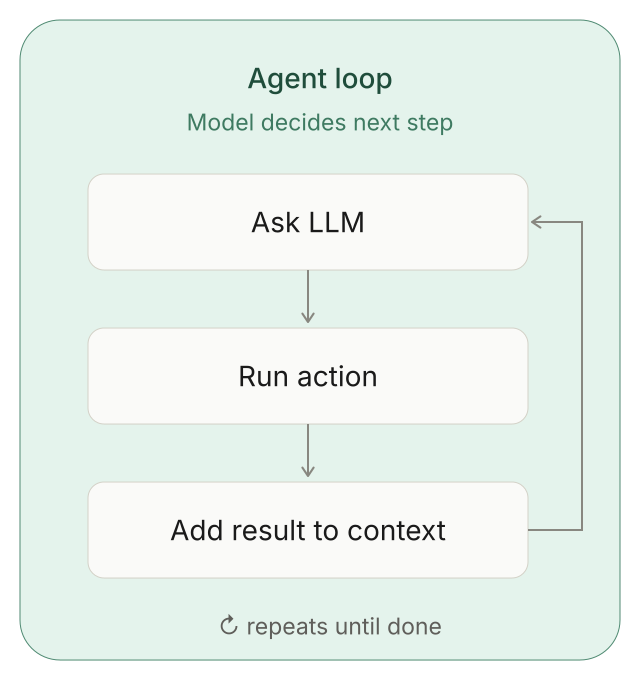
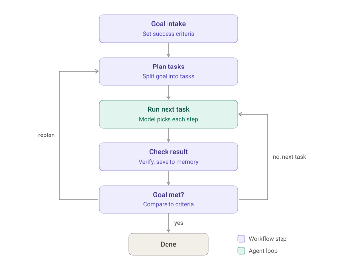

# Week 5 · Agent Engineering — Concepts

## At a glance

| Learn | Build | Key terms | Watch for |
| --- | --- | --- | --- |
| What an agent is made of, and how to build one that stays in control | An agent: a loop, a harness, and a workflow | Agent loop, harness, workflow | The model proposes the next step; your code decides what is allowed to happen |

An **agent** pursues a goal across many steps instead of answering in one call. This page answers two questions: **what an agent looks like**, and **how you implement one**. For short definitions of any term, see the **Glossary**.

## 1. What an agent looks like

An agent is a **harness wrapped around an LLM**, driven by a short **loop**. The model supplies judgment on each turn; the harness holds state, runs actions, and keeps the whole thing bounded.

### 1.1 The agent loop

An agent runs a short cycle over and over: ask the model what to do next, run that action, add the result back into the context, and repeat until the goal is met or a limit is hit.

The key point is that **the model decides the next step on every turn**. That is what makes it an agent rather than a fixed script: the path is not written in advance, it emerges from each result. The loop keeps going while there is more to do and stops when the goal is reached, a step/budget limit is hit, or it needs a human.

### 1.2 The harness

The model only ever receives a prompt and returns a proposed next action — it is stateless between calls and cannot touch the outside world. Everything that makes the loop dependable lives in the **harness**, the code you control.

| Harness part | What it does |
| --- | --- |
| **Agent loop** | Repeats ask → act → observe until done |
| **Context** | Builds the prompt sent to the model each turn |
| **Memory** | Persists state and facts across steps |
| **Tools** | Run real actions and reach the environment (files, shell, APIs) |
| **Guardrails** | Enforce limits, permissions, and approvals |

> 🎯 Reliability, cost control, and safety come from the **harness**, not the model. The model supplies judgment; the harness decides what that judgment is actually allowed to do.

## 2. How do we implement an agent

Building an agent is mostly deciding where the model gets freedom and where your code stays in charge. Design the **workflow** first, then let the loop run only inside the stages that genuinely need judgment.

### 2.1 Design the workflow

A loop on its own can wander. A **workflow** gives it a map: the fixed stages a task moves through and the legal transitions between them. The agent loop runs inside the open-ended stage; the stages around it are deterministic steps you control.

This hybrid is what keeps an agent bounded. The surrounding stages — intake, planning, checking the result against the goal — are plain code with known transitions. Only **Run next task** hands control to the model-driven loop, and only until that task is done. Every run ends at a defined terminal state (`done`, or `failed` with a reason), so the agent has freedom exactly where judgment is needed and nowhere else.

> 💡 If you can draw the whole decision tree before running it, you want a fixed workflow, not an agent. Reserve the agent loop for the stages where a runtime result genuinely changes what should happen next.

### 2.2 Build it in order

With the workflow drawn, the rest is filling it in — structure first, model last.

1. **Define the workflow** — stages, legal transitions, and terminal states — before writing any prompt.
2. **Build the control loop** that runs each stage, updates state, and stops as soon as state is terminal.
3. **Let the model drive only the open-ended stage**; keep known decisions in code.
4. **Give every tool an owner:** validate its arguments, check permissions, and require approval for risky actions.
5. **Bound every loop** — max steps, budget, timeout — each ending in a terminal state with a reason, never a crash.
6. **Trace every step** so any run can be explained, saved, and evaluated.

> 🛡️ Tool results and retrieved text are **evidence, not instructions**. Treat external responses as untrusted input, and enforce tool permissions and approval gates in the harness, never in the prompt alone.

### 2.3 Keep a human in the loop

Some actions are too costly to undo for the agent to take on its own — sending a message, spending money, deleting data, changing production. For these, the loop should **pause and ask a person to approve** before the tool runs, then resume with the decision recorded in state.

An approval gate is just another guardrail, but instead of ending the run it moves it into a **paused** state: the agent waits for a human decision rather than stopping. The model may *propose* a risky action; only an approval lets the tool actually run.

| The agent may act on its own | Require human approval first |
| --- | --- |
| Read-only or easily reversible actions — search, read a file, draft text | Irreversible or high-impact actions — send, pay, delete, publish, change production |

> 🧭 Keep the gate in the harness, not the prompt, and record **who approved what**. A model can be talked out of a rule; an approval check in code cannot, and the trace then explains every side effect.

## References

- [OpenAI API — Agents](https://developers.openai.com/api/docs/guides/agents)
- [Anthropic — Building effective agents](https://www.anthropic.com/engineering/building-effective-agents)
- [OWASP — AI Agent Security Cheat Sheet](https://cheatsheetseries.owasp.org/cheatsheets/AI_Agent_Security_Cheat_Sheet.html)
- [Hugging Face Agents Course](https://huggingface.co/learn/agents-course/en/unit1/introduction)
