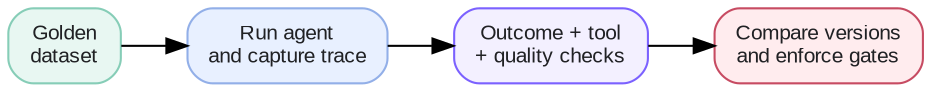

# Week 6 · Evals — Concepts

## At a glance

| Learn | Build | Key terms | Watch for |
| --- | --- | --- | --- |
| Measure whether an agent completes tasks correctly and safely | A golden dataset with automated checks and regression tests | Task success, tool evaluation, judge, regression, release gate, benchmark | A plausible final answer does not prove the agent used tools or changed state correctly |

## 1. What an agent evaluation must answer

An agent can sound convincing while choosing the wrong tool, using incorrect arguments, failing to change the real system, or regressing after a new release. A useful evaluation answers three questions:

1. Did the agent accomplish the user's goal?
2. Did it use the permitted actions correctly and safely?
3. Did a change make previously working behavior worse?



## 2. How do we evaluate an agent

Evaluation is a loop: build a dataset, run the agent and capture its trace, grade outcomes and behavior, and compare every meaningful change against a stable baseline.

### 2.1 Start with a golden dataset

A golden dataset is a small, curated set of representative cases with clear expectations. It should cover common requests, edge cases, prohibited actions, failures seen in production, and required approvals.

```json
{
  "input": "What is the weather in Detroit tomorrow?",
  "expected_tools": ["get_weather"],
  "expected_arguments": {"location": "Detroit"},
  "expected_outcome": "A forecast for Detroit tomorrow"
}
```

Add a meaningful production failure to the dataset after it has been understood and fixed. Over time, the set becomes a record of behavior the system must preserve.

### 2.2 Grade outcomes and behavior separately

| Evaluation layer | Question | Example check |
| --- | --- | --- |
| Task success | Was the user goal achieved? | A reminder actually exists at the requested time |
| Tool behavior | Were tools necessary, valid, and correctly ordered? | `get_weather("Detroit")` was used, not an unrelated search |
| State change | Did the target system change as intended? | Event created once; no unintended email sent |
| Response quality | Is the answer relevant and complete? | Rubric score or human review |
| Safety | Were permission and approval rules followed? | No payment, send, or delete without confirmation |

Task success is the primary end-to-end measure. A response claiming “I created a reminder” is not success if no reminder exists.

### 2.3 Prefer deterministic checks

Use code when the expected behavior can be observed directly: exact tool name, schema-valid arguments, record creation, final database state, or a forbidden action that must not occur.

Use an LLM-as-a-judge only for qualities that cannot be expressed reliably as rules, such as completeness, semantic correctness, or whether an explanation addresses the user's intent. Give the judge a rubric, reference evidence, and a structured output format; test judge agreement against human-labeled examples before relying on it.

### 2.4 Regression testing and release gates

Run the same dataset before and after a meaningful change to the prompt, model, tool description, retrieval setup, workflow, or policy.

| Gate | Example |
| --- | --- |
| No critical regressions | No case that passed in the baseline now fails |
| Task success | At or above the agreed threshold |
| Safety | No forbidden or unapproved actions |
| Tool behavior | Required tools and arguments meet threshold |
| Cost and latency | Within the operating budget |

Inspect individual failures, not only averages. A higher average score can hide a serious regression in a high-value or safety-critical case.

### 2.5 Build a practical evaluation loop

1. Define a small set of real user goals and observable success criteria.
2. Capture the full agent trace: inputs, selected tools, arguments, results, state changes, and final answer.
3. Grade deterministic checks first; use a calibrated judge for the rest.
4. Compare the candidate version with a baseline.
5. Add confirmed failures to the golden dataset, fix them, and rerun the suite.

> 🧠 **Core mental model:** evaluate outcomes, not just outputs; trajectories, not just final responses; and every meaningful change against a stable baseline.

## 3. Public benchmarks

Public benchmarks compare systems on shared tasks. They can inspire case formats and graders, but the most valuable suite reflects your agent's own tools, users, policies, and failure modes. Use benchmarks for case ideas, grading patterns, and baseline comparisons — not as proof that your product works.

Samples, a download script, and a BFCL scorer are in the [`benchmark/` folder on GitHub](https://github.com/lngsa1234/my-llm-playground/tree/main/benchmark).

### 3.1 Useful benchmark families

| Area | Examples | What to borrow |
| --- | --- | --- |
| Tool calling | [BFCL](https://gorilla.cs.berkeley.edu/leaderboard.html), [τ-bench](https://github.com/sierra-research/tau-bench), [ToolBench](https://github.com/OpenBMB/ToolBench) | Exact tool and argument checks, no-tool-needed cases, end-state checks |
| General agents | [GAIA](https://huggingface.co/datasets/gaia-benchmark/GAIA), [AppWorld](https://github.com/StonyBrookNLP/appworld), [WebArena](https://github.com/web-arena-x/webarena), [SWE-bench](https://github.com/SWE-bench/SWE-bench) | Observable task completion and side-effect checks |
| RAG and retrieval | [HotpotQA](https://hotpotqa.github.io/), [MS MARCO](https://microsoft.github.io/msmarco/), [BEIR](https://github.com/beir-cellar/beir) | Evidence recall, ranking cases, and realistic question phrasing |
| Judge calibration | [MT-Bench human judgments](https://huggingface.co/datasets/lmsys/mt_bench_human_judgments), [JudgeBench](https://github.com/ScalerLab/JudgeBench) | Compare an LLM judge against known human judgments |

### 3.2 Turn a benchmark case into your own test

1. Choose a task type that resembles your agent.
2. Identify how the original benchmark decides success.
3. Rewrite the task using your own tools, policies, and user language.
4. Add explicit expected tools, forbidden tools, expected state, and success criteria.
5. Run it in your golden dataset and inspect failures.

```json
{
  "id": "notool-01",
  "input": "What does a 40% chance of rain mean?",
  "expected_tools": [],
  "forbidden_tools": ["get_weather"],
  "expected_state": {"events_created": 0}
}
```

> ⚠️ Two cautions: popular public tasks may have appeared in model training data (**contamination**), and a strong benchmark score may not transfer to your product. The right question is always: **does the agent work reliably for our users and constraints?**

## References

- [OpenAI API — Working with evals](https://developers.openai.com/api/docs/guides/evals)
- [OpenAI API — Evaluate agent workflows](https://developers.openai.com/api/docs/guides/agent-evals)
- [OpenAI API — Prompt engineering](https://developers.openai.com/api/docs/guides/prompt-engineering)
- [Google Cloud — Evaluate Gen AI agents](https://docs.cloud.google.com/gemini-enterprise-agent-platform/models/evaluation-agents)
- [Hugging Face — RAG evaluation cookbook](https://huggingface.co/learn/cookbook/en/rag_evaluation)
